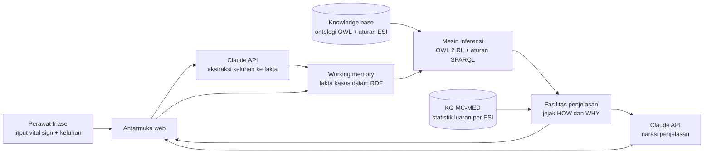
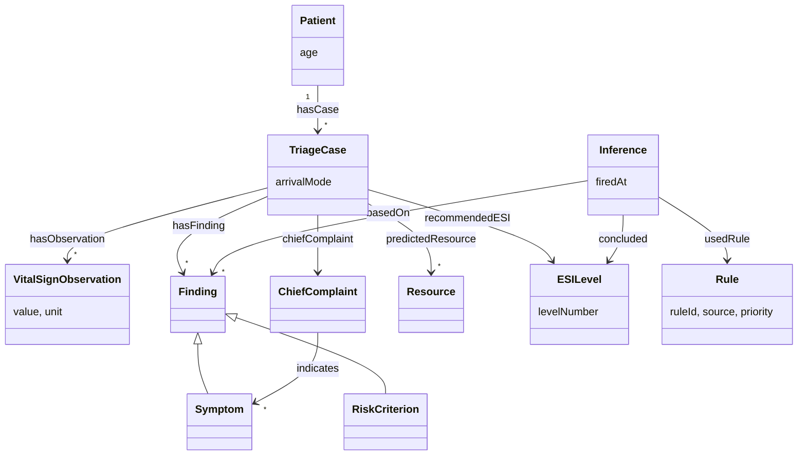
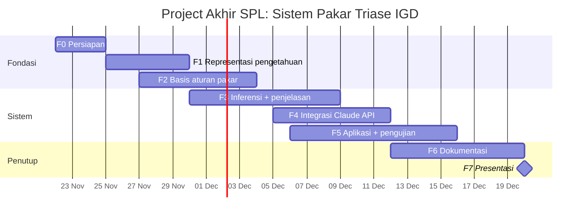

# Roadmap Sistem Pakar Triase IGD

Catatan induk project akhir Sistem Pakar Lanjut. Sistem yang dibangun adalah **sistem pakar pendukung triase IGD berbasis Emergency Severity Index (ESI) versi 4**. Inti sistem adalah knowledge graph dan aturan IF-THEN dari pakar; LLM (Claude API) hanya membantu di tepi sistem: mengubah keluhan teks bebas menjadi fakta terstruktur dan menulis ulang penjelasan dalam bahasa yang mudah dipahami.

> [!info] Titik awal
> Project ini melanjutkan [[Bahan Ajar Knowledge Graph - Triase IGD|Tugas 4 Knowledge Graph Triase IGD]]. KG `triagekg` (118.385 kunjungan MC-MED) beserta aturan R1 sampai R3 sudah berjalan di GraphDB. Panduan demonya ada di [[Panduan Demo GraphDB - Triase IGD]].

> [!warning] Asumsi yang perlu dikonfirmasi
> - Tanggal presentasi belum tercantum pada soal. Roadmap ini mengasumsikan **20 Desember 2026** (4 minggu dari hari ini). Geser seluruh tenggat apabila tanggalnya berbeda.
> - Anggota kelompok (3 sampai 4 orang) belum ditetapkan. Pembagian peran di [[#Pembagian peran kelompok]] dapat disesuaikan.

## Peta komponen wajib

| Komponen wajib (soal) | Wujud pada sistem ini | Fase |
| --- | --- | --- |
| Knowledge representation (ontologi + KG) | Ontologi OWL `triage.ttl` (TBox) + KG kasus dan statistik MC-MED (ABox), disimpan sebagai RDF | [[#F1 Perbaikan representasi pengetahuan]] |
| Rules dari pakar + referensi | 15 sampai 25 aturan ESI v4, danger zone pediatrik, qSOFA, shock index; setiap aturan mencantumkan sumbernya | [[#F2 Basis aturan dari pakar]] |
| Reasoning + penjelasan | Forward chaining (OWL 2 RL + aturan SPARQL) dengan jejak penalaran: aturan apa, fakta apa, kesimpulan apa | [[#F3 Mesin inferensi dan penjelasan]] |
| Metode lain (opsional) | Claude API untuk ekstraksi keluhan utama dan narasi penjelasan | [[#F4 Integrasi LLM Claude API]] |
| Laporan PDF, PPT, repo GitHub + README | Fase penutup | [[#F6 Dokumentasi dan deliverable]] |

## Arsitektur



Pembagian tanggung jawab ini sengaja tegas: **level ESI hanya ditentukan oleh mesin inferensi**. Claude tidak pernah memutuskan level ESI. Apabila hasil ekstraksi Claude meragukan, sistem menanyakannya kembali kepada pengguna. Prinsip ini sejalan dengan materi [[Intro ES.pdf#page=17|sistem hibrida pada Intro ES]].

## Rujukan materi setelah UTS

| Materi | Digunakan untuk | Fase |
| --- | --- | --- |
| [[Intro ES.pdf]] | Tiga blok pembangun sistem pakar (knowledge base, inference engine, user interface), argumen hibrida ES + ML/LLM | Pendahuluan laporan, F3, F4 |
| [[KR-Knowledge-Graphs.pdf]] | Pilihan representasi pengetahuan, alasan memilih knowledge graph | F1 |
| [[RDFS.pdf]] | `rdfs:subClassOf`, `domain`, `range`, entailment RDFS (fakta + skema) | F1, F3 |
| [[SPARQL-Reasoning.pdf]] | SPARQL SELECT/ASK/CONSTRUCT/INSERT, reasoning OWL, aturan | F2, F3 |

Catatan sebelum UTS yang relevan: [[00 - Peta Mata Kuliah]] (CPMK .2 dan .4) dan [[04 - Studi Kasus Evaluasi Kesesuaian Lahan]] sebagai contoh sistem pakar utuh. Logika fuzzy dari [[02 - Inferensi Fuzzy Mamdani]] dapat menjadi pengayaan di F2 (lihat [[#Pengayaan opsional]]).

---

## F0 Persiapan proyek

Tenggat: **24 November 2026**

- [ ] Konfirmasi tanggal presentasi dan anggota kelompok
- [x] Buat repository GitHub `sistem-pakar-triase-igd` (publik; data credentialed tidak ikut, dicek gitleaks sebelum setiap push)
- [x] Siapkan struktur folder di `Sistem Pakar - ED/` (antarmuka web dipisah ke `web/`):
  ```text
  Sistem Pakar - ED/
  ├── kb/            ontologi + aturan (.ttl, .rq)
  ├── data/          kasus uji sintetis + MIMIC-IV-ED demo (TIDAK berisi MC-MED)
  ├── app/           backend FastAPI + halaman web
  ├── tests/         pytest (aturan) + Playwright (end-to-end)
  ├── docs/          laporan, gambar, PPT
  └── README.md
  ```
- [x] Python 3.10 dengan `venv`; dependensi awal: `rdflib`, `owlrl`, `fastapi`, `uvicorn`, `anthropic`, `pytest`, `pytest-playwright`
- [x] Simpan `ANTHROPIC_API_KEY` di `.env`, masukkan `.env` ke `.gitignore` (dibaca otomatis oleh `app/__init__.py`)

> [!danger] Kepatuhan data PhysioNet
> MC-MED dan MIMIC-IV-ED berlisensi credentialed. File `triagekg.ttl` (65 MB, data tingkat kunjungan) **tidak boleh masuk repository publik**. Repository hanya memuat ontologi, aturan, statistik agregat, kasus sintetis, dan subset demo yang lisensinya terbuka.

## F1 Perbaikan representasi pengetahuan

Tenggat: **29 November 2026**

> [!success] Rancangan v2.0 sudah selesai dan tervalidasi
> Dokumentasi lengkap: [[01 - Representasi Pengetahuan]]. File: `kb/triage-ontology.ttl`, `kb/shapes.ttl`, `kb/rules/`, `kb/check_kb.py`.

### Kelemahan KG Tugas 4

KG Tugas 4 kuat sebagai **gudang data** (118 ribu kunjungan), namun lemah sebagai **knowledge base sistem pakar**:

1. Konsep klinis belum menjadi kelas. Vital sign hanya berupa angka pada `EDVisit`; tidak ada kelas `VitalSign`, `Symptom`, `ChiefComplaint`, `Resource`, atau `DecisionPoint`.
2. Aturan tertanam di dalam teks SPARQL, bukan di dalam graph. Sistem tidak dapat menjawab "aturan apa yang ada" atau "dari mana aturan ini berasal".
3. Ambang danger zone hanya untuk dewasa, padahal ESI v4 membedakan ambang menurut usia.
4. Tidak ada provenance: kesimpulan `UndertriageCandidate` tidak mencatat fakta mana yang memicunya.
5. ICD-10 hanya kode datar, tanpa hierarki bab dan blok.

### Rancangan ontologi baru



Langkah kerja:

- [x] Pisahkan TBox ke `kb/triage-ontology.ttl` dengan kelas di atas; pertahankan IRI lama (`ex:EDVisit`, `ex:ESILevel`, dst.) melalui `owl:equivalentClass` agar query Tugas 4 tetap berjalan
- [x] ~~Modelkan vital sign sebagai observasi SOSA~~ diganti anotasi `ex:measures` pada property tanda vital (keputusan K5 di [[01 - Representasi Pengetahuan#Keputusan desain]])
- [x] Representasikan **aturan sebagai individu** kelas `ex:Rule` (id, deskripsi, sumber DOI/URL, prioritas); teks SPARQL-nya disimpan di `kb/rules/*.rq`
- [ ] Tambahkan hierarki ICD-10-CM (bab, blok, kode) dari data publik CMS (sebagian: kode blok ICD-10 pada 11 riwayat penyakit di v2.2, hierarkinya belum)
- [ ] Tambahkan kosakata gejala dari Symptom Ontology (SYMP) untuk 30 sampai 50 keluhan utama tersering
- [x] Validasi bentuk data kasus dengan **SHACL** (`kb/shapes.ttl`): vital sign wajib numerik, rentang masuk akal, usia wajib ada
- [x] Gambar ulang diagram ontologi (`docs/figures/ontologi.png`, `docs/figures/ba-hierarki-tbox.png`)

### Database yang perlu diunduh

| Sumber | Isi yang diambil | Lisensi / akses | Prioritas |
| --- | --- | --- | --- |
| [ESI Implementation Handbook v4 (AHRQ/ENA)](https://www.ahrq.gov/patient-safety/settings/emergency-dept/esi.html) | Algoritma 4 decision point, danger zone vital sign per usia, daftar resource | Publik | Wajib |
| [ICD-10-CM (CMS)](https://www.cms.gov/medicare/coding-billing/icd-10-codes) | Hierarki bab, blok, kode | Publik | Wajib |
| [Symptom Ontology (OBO Foundry)](https://obofoundry.org/ontology/symp.html) | Kelas gejala + sinonim | CC0 | Wajib |
| [MIMIC-IV-ED Demo (PhysioNet)](https://physionet.org/content/mimic-iv-ed-demo/) | 100 pasien, tabel `triage` lengkap dengan keluhan teks; kasus uji dan demo publik | ODbL, terbuka | Wajib |
| MC-MED 1.0.0 (sudah ada di `Thesis Preparation/Dataset`) | Statistik agregat luaran per ESI untuk bukti pada penjelasan | Credentialed, lokal saja | Sudah ada |
| [MIMIC-IV-ED penuh](https://physionet.org/content/mimic-iv-ed/) | Evaluasi skala besar, termasuk teks keluhan | Credentialed | Opsional |

## F2 Basis aturan dari pakar

Tenggat: **3 Desember 2026**

Setiap aturan ditulis dalam tiga bentuk: kalimat IF-THEN untuk laporan, individu `ex:Rule` di graph, dan query SPARQL `INSERT` yang dijalankan mesin inferensi.

### Kelompok aturan

| Kelompok | Contoh aturan | Sumber |
| --- | --- | --- |
| A. Intervensi penyelamatan nyawa | IF pasien apnea / tanpa nadi / butuh intubasi segera / SpO2 < 90 dengan distres berat THEN ESI 1 | ESI Handbook v4, Decision Point A |
| B. Situasi risiko tinggi | IF nyeri dada khas sindrom koroner akut THEN ESI 2; IF baru bingung/letargi/disorientasi THEN ESI 2; IF nyeri ≥ 7/10 THEN pertimbangkan ESI 2 | ESI Handbook v4, Decision Point B |
| C. Jumlah resource | IF butuh ≥ 2 resource THEN ESI 3; IF 1 resource THEN ESI 4; IF tanpa resource THEN ESI 5 | ESI Handbook v4, Decision Point C |
| D. Danger zone vital sign | IF usia > 8 th AND (HR > 100 OR RR > 20) THEN DangerZone; ambang khusus usia < 3 bln, 3 bln sampai 3 th, 3 sampai 8 th; IF SpO2 < 92 THEN DangerZone | ESI Handbook v4, Decision Point D |
| E. Uptriage | IF DangerZone AND ESI kandidat ≥ 3 THEN pertimbangkan ESI 2 | ESI Handbook v4 (R2 Tugas 4) |
| F. Skor pendukung | IF RR ≥ 22 + perubahan mental + SBP ≤ 100 (≥ 2 dari 3) THEN qSOFA positif → curiga sepsis → risiko tinggi | Singer dkk., JAMA 2016 (Sepsis-3) |
| G. Skor pendukung | IF HR / SBP > 1,0 THEN shock index tinggi → risiko tinggi | Allgöwer & Burri, 1967; validasi IGD terkini |

Langkah kerja:

- [x] Tulis 15 sampai 25 aturan di `kb/rules/` (24 aturan pada v2.2) dengan nama `A01_apnea.rq`, `D03_hr_anak.rq`, dst.
- [x] Tetapkan **prioritas** (A > B > D/E > C) sebagai strategi resolusi konflik; level ESI akhir = level paling akut dari aturan yang terpicu
- [x] Susun **tabel keputusan** (decision table) per decision point untuk lampiran laporan (Bab 7 bahan ajar)
- [ ] Minta validasi minimal satu tenaga kesehatan (perawat/dokter IGD) sebagai "pakar"; catat nama, tanggal, dan revisi yang diusulkan
- [ ] Pertahankan R1 sampai R3 Tugas 4 sebagai aturan analitik atas data MC-MED

## F3 Mesin inferensi dan penjelasan

Tenggat: **8 Desember 2026**

### Strategi penalaran

1. **Entailment OWL 2 RL** dengan `owlrl` (subclass, equivalentClass, hasValue, inverseOf), sama seperti ruleset GraphDB di Tugas 4.
2. **Forward chaining aturan SPARQL** dalam siklus *match, resolve, act* sampai titik tetap (tidak ada triple baru). Urutan ini penting karena aturan E membaca hasil aturan D, persis seperti R2 membaca hasil R1.
3. **Penjelasan**: setiap aturan yang terpicu menulis node `ex:Inference` di named graph `graph/penjelasan`:

```turtle
ex:inf_001 a ex:Inference ;
    ex:usedRule ex:Rule_D04 ;
    ex:basedOn ex:case42_hr , ex:case42_age ;
    ex:concluded ex:DangerZone ;
    rdfs:comment "HR 128 > 100 pada usia 45 tahun" .
```

Dari graph ini sistem menjawab dua jenis pertanyaan klasik sistem pakar:

- **HOW**: "Mengapa ESI 2?" → telusuri rantai `ex:Inference` mundur sampai fakta masukan.
- **WHY**: "Mengapa sistem menanyakan tingkat nyeri?" → tampilkan aturan yang sedang menunggu fakta tersebut.

Sebagai bukti empiris, penjelasan juga menampilkan statistik MC-MED dari Q2 dan Q5 Tugas 4, misalnya persentase luaran kritis pada kelompok kandidat undertriage dibanding ESI 3 sampai 5 lainnya.

Langkah kerja:

- [x] Modul `app/engine.py`: muat ontologi + aturan, terima fakta kasus, jalankan siklus inferensi, kembalikan level ESI + graph penjelasan
- [x] Tangani data yang tidak lengkap: apabila fakta kunci kosong, mesin mengembalikan pertanyaan lanjutan, bukan menebak
- [x] Simpan statistik agregat MC-MED ke `kb/evidence.ttl` (angka agregat saja)
- [x] Opsional: jalankan versi yang sama di GraphDB 11 untuk demo visual graph (repository `triage-es`, paritas hasil diuji)

## F4 Integrasi LLM Claude API

Tenggat: **11 Desember 2026**

| Peran Claude | Masukan | Keluaran | Batasan |
| --- | --- | --- | --- |
| Ekstraksi keluhan utama | Teks bebas, mis. "nyeri dada menjalar ke lengan kiri sejak 1 jam, keringat dingin" | JSON terstruktur: daftar gejala (IRI SYMP), skala nyeri, onset | Skema JSON ketat (tool use / structured output); IRI di luar kosakata ditolak |
| Narasi penjelasan | Graph penjelasan (HOW) dalam JSON | Paragraf bahasa Indonesia untuk perawat | Hanya merangkai fakta dari graph; dilarang menambah fakta baru |
| Tanya jawab KG (opsional) | Pertanyaan bahasa alami | Query SPARQL `SELECT` hanya-baca | Query divalidasi sebelum dijalankan |

Langkah kerja:

- [x] `app/llm.py` dengan SDK `anthropic`; model `claude-haiku-5-5` untuk ekstraksi, narasi, dan penjelasan AI
- [x] Prompt caching untuk system prompt yang memuat daftar kosakata gejala
- [x] Mode tanpa LLM (`LLM_ENABLED=0`): form terstruktur tetap berfungsi penuh, sehingga demo aman apabila koneksi internet bermasalah
- [ ] Uji 20 keluhan dari MIMIC-IV-ED demo: bandingkan hasil ekstraksi dengan anotasi manual

## F5 Aplikasi dan pengujian

Tenggat: **15 Desember 2026**

### Aplikasi

- [x] Backend FastAPI: `POST /api/assess`, `POST /api/explain`, `GET /api/rules`, `GET /api/vocab`, `GET /api/health`
- [x] Halaman web: form vital sign + keluhan, kartu hasil ESI berwarna, panel penjelasan (pohon HOW), tombol "Mengapa ditanyakan?" (WHY)
- [ ] Riwayat konsultasi cukup disimpan dalam berkas JSON/SQLite lokal (tidak dikerjakan: data pasien sengaja tidak disimpan)

### Pengujian

- [x] **Unit test aturan** (pytest): 30 kasus emas (35 kasus emas, total 73 tes), minimal satu kasus per aturan, termasuk kasus batas (HR tepat 100, SpO2 tepat 92, usia tepat 3 bulan)
- [x] **End-to-end** dengan Playwright (8 skenario): isi form → hasil ESI → buka penjelasan → mode tanpa LLM
- [ ] **Evaluasi**: bandingkan ESI rekomendasi sistem dengan ESI perawat pada MIMIC-IV-ED demo; laporkan akurasi, tabel confusion matrix, dan analisis undertriage/overtriage

> [!note] Playwright MCP
> Koneksi Playwright MCP sudah diperbaiki (dipasang global, dijalankan dengan Chrome). Pengujian otomatis tetap memakai `pytest-playwright`; MCP digunakan untuk pemeriksaan tampilan.

## F6 Dokumentasi dan deliverable

Tenggat: **19 Desember 2026**

- [x] **README.md**: deskripsi, arsitektur, cara instalasi, cara menjalankan (`uvicorn app.main:app`), cara menjalankan tes, variabel lingkungan, catatan lisensi data
- [x] **Laporan PDF** dengan struktur (versi 16 aturan; perlu diperbarui ke v2.2):
  1. Pendahuluan (masalah undertriage di IGD, tujuan)
  2. Tinjauan pustaka (sistem pakar, KG, ESI v4, sistem hibrida ES + LLM)
  3. Akuisisi pengetahuan (sumber, wawancara pakar, tabel keputusan)
  4. Representasi pengetahuan (ontologi, diagram kelas, contoh triple)
  5. Basis aturan (daftar lengkap IF-THEN + referensi)
  6. Mesin inferensi dan penjelasan (forward chaining, contoh jejak HOW/WHY)
  7. Integrasi LLM (peran, batasan, contoh)
  8. Implementasi dan pengujian (tangkapan layar, hasil tes, evaluasi)
  9. Kesimpulan, keterbatasan, saran
- [x] **PPT** 12 sampai 15 slide (17 slide + 15 slide materi; perlu diperbarui ke v2.2); skrip build PPT Tugas 4 (`build_ppt_v3.py`) dapat menjadi titik awal
- [ ] Skenario demo 5 menit dengan tiga kasus: dewasa nyeri dada (ESI 2), anak demam dengan danger zone (uptriage), keseleo pergelangan kaki (ESI 4/5)

## F7 Gladi dan presentasi

Tenggat: **20 Desember 2026**

- [ ] Gladi presentasi dua kali, catat pertanyaan sulit
- [ ] Siapkan jawaban: "Mengapa tidak murni ML?", "Bagaimana jika LLM berhalusinasi?", "Bagaimana aturan divalidasi?", "Apa beda reasoning OWL dengan aturan SPARQL?"
- [ ] Rekam video demo cadangan

---

## Pekerjaan di luar rencana awal (selesai)

- [x] Audit klinis sebagai perawat triase dan rencana perbaikan: [[03 - Audit Klinis dan Rencana Perbaikan]]
- [x] Mode perawat dan model data pasien (ontologi v2.2: riwayat, obat, kehamilan, onset, lokasi nyeri; aturan B06 sampai B12 dan G02)
- [x] Dokumen data dan sumber: [[04 - Data dan Sumber Pengetahuan]], [[05 - Memahami Berkas TTL]], [[06 - Asal Pengetahuan (Buku dan Data)]]
- [x] Bahan ajar TBox, ABox, dan aturan (52 halaman) beserta ringkasan presentasi (13 halaman), PDF dan Word
- [x] Versi ringkas knowledge graph tanda vital dewasa (`kb-tanda-vital/`)
- [x] Excel data kunjungan MC-MED berkomentar (lokal, `data/processed/`)
- [x] PDF buku ESI berstabilo dan berkomentar per aturan (lokal, `data/sumber/`)
- [x] Penjelasan AI berbasis KG-RAG: detail klinis, insight, detail teknis, TBox, ABox, dan pertanyaan lanjutan
- [x] Skrip perbaikan Docker Desktop (`tools/perbaiki_docker.ps1`)

## Sisa pekerjaan utama

- [ ] Perbarui laporan akhir, PPT, dan dokumen pendukung ke ontologi v2.2 (24 aturan, mode perawat, penjelasan AI)
- [ ] Tambahkan nama anggota kelompok di sampul laporan dan PPT
- [ ] Validasi aturan oleh perawat atau dokter IGD, terutama B06, B08, B12
- [ ] Evaluasi dengan kasus latihan Bab 9 dan 10 buku ESI (audit V1)
- [ ] Video demo (motion video)
- [ ] Deploy (opsional)

## Linimasa



## Pembagian peran kelompok

| Peran | Tanggung jawab utama | Fase |
| --- | --- | --- |
| Knowledge engineer | Ontologi, SHACL, data ICD-10 dan SYMP | F1 |
| Akuisisi pengetahuan | Basis aturan, tabel keputusan, wawancara pakar | F2 |
| Backend + inferensi | Mesin inferensi, penjelasan, integrasi Claude | F3, F4 |
| Frontend + QA + dokumen | Halaman web, Playwright, README, laporan, PPT | F5, F6 |

Untuk kelompok tiga orang, gabungkan peran pertama dan kedua.

## Pengayaan opsional

- **Ketidakpastian**: tambahkan certainty factor pada aturan kelompok B, atau inferensi fuzzy Mamdani untuk skala nyeri dan vital sign di sekitar ambang (menghubungkan materi sebelum dan sesudah UTS, CPMK .3).
- **Machine learning pembanding**: model gradient boosting dari MC-MED sebagai baseline; tunjukkan bahwa sistem pakar unggul dalam keterjelasan, bukan selalu dalam akurasi.

## Risiko dan mitigasi

| Risiko | Dampak | Mitigasi |
| --- | --- | --- |
| Data credentialed bocor ke GitHub | Pelanggaran lisensi PhysioNet | `.gitignore` untuk `data/private/`, cek `git status` sebelum push |
| API Claude gagal saat demo | Demo terhenti | Mode tanpa LLM + video cadangan |
| Pakar sulit ditemui | Aturan tanpa validasi | Rujuk ESI Handbook sebagai pengetahuan pakar terdokumentasi; validasi melalui pesan tertulis |
| `triagekg.ttl` 65 MB lambat di rdflib | Aplikasi lambat | Aplikasi hanya memuat ontologi, aturan, dan statistik agregat; data kunjungan penuh tetap di GraphDB |

## Log keputusan

| Tanggal | Keputusan | Alasan |
| --- | --- | --- |
| 2026-11-22 | Domain: triase IGD berbasis ESI v4 | Melanjutkan KG Tugas 4, data dan referensi sudah tersedia |
| 2026-11-22 | Mesin inferensi dengan `rdflib` + `owlrl` di aplikasi; GraphDB untuk demo visual | Aplikasi mandiri tanpa server GraphDB, mudah dijalankan penguji dari README |
| 2026-11-22 | Claude tidak menentukan level ESI | Sistem pakar tetap inti; keputusan dapat ditelusuri ke aturan dan sumbernya |
| 2026-11-23 | Pengguna utama: perawat triase, mode awam sebagai pra-triase | ESI adalah alat perawat; penilaian AVPU dan resource butuh tenaga terlatih |
| 2026-11-25 | Model Claude: Haiku 5.5; penjelasan AI memakai KG-RAG | Cepat dan murah; Claude hanya menerima potongan knowledge graph kasus sehingga tidak dapat mengarang atau mengubah level |
