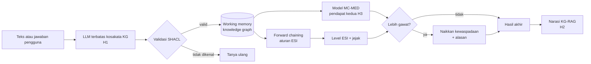

# Audit Klinis, Representasi Pengetahuan, dan Antarmuka

Dokumen ini mencatat apa yang perlu diperbaiki pada aplikasi **Perlu ke IGD?** setelah ditinjau dari sudut pandang perawat triase IGD. **Belum ada perubahan kode.** Setiap temuan memuat masalah, dasar klinis atau sumbernya, dan usulan perbaikan, sehingga pemilik dapat memilih urutan pengerjaan.

> [!success] Keputusan pemilik (23 November 2026)
> **Perawat triase sebagai pengguna utama**, dengan mode awam sebagai pra-triase. Tahap 1 (U1-U3) mulai dikerjakan.

> [!important] Keputusan yang perlu diambil lebih dulu
> **Siapa pengguna utama: perawat triase atau orang awam?** ESI dirancang sebagai alat perawat terlatih. Beberapa penilaiannya (AVPU, perkiraan resource, tanda vital terukur) tidak dapat dilakukan orang awam secara andal. Rekomendasi auditor: **perawat sebagai pengguna utama sistem pakar** (mode lengkap), dengan **mode awam** sebagai pra-triase sederhana yang mengarahkan "segera ke IGD / ke IGD hari ini / cukup ke klinik". Keputusan ini memengaruhi hampir semua temuan di bawah.

## 1. Ringkasan temuan

| ID | Area | Temuan | Prioritas |
| --- | --- | --- | --- |
| U1 | Antarmuka HP | Detail teknis terpotong di sisi kanan dan harus digeser | P1 |
| U2 | Antarmuka laptop | Laci detail teknis tidak dapat diperlebar untuk presentasi | P2 |
| U3 | Alur | Tombol "Lihat hasil sekarang" pada pertanyaan tanda bahaya membingungkan | P2 |
| K1 | Persona | ESI adalah alat perawat; mode awam dan mode perawat belum dipisahkan | P1 |
| K2 | Anamnesis | Waktu dan cara mulainya keluhan (onset) tidak ditanyakan | P1 |
| K3 | Anamnesis | Lokasi dan penjalaran nyeri tidak ditanyakan | P1 |
| K4 | Anamnesis | Riwayat penyakit, obat (terutama pengencer darah), alergi, dan kehamilan tidak ditanyakan | P1 |
| K5 | Penilaian | Derajat sesak napas (ringan, sedang, berat) tidak terukur | P1 |
| K6 | Tanda vital | Tekanan darah, kesadaran, dan gula darah belum lengkap; awam tidak tahu cara mengukur | P2 |
| K7 | Alur | Pertanyaan tidak menyesuaikan keluhan (tidak ada pertanyaan lanjutan) | P1 |
| K8 | Cakupan | Beberapa kondisi gawat belum ada (kejang, anafilaksis, keracunan, luka bakar, hipoglikemia, dsb.) | P1 |
| K9 | Penilaian | Jawaban "tidak tahu" dan ketidakpastian belum ditangani | P2 |
| R1-R7 | Representasi | Model pasien, keluhan terstruktur, kelas turunan, pertanyaan adaptif, provenance sumber fakta, terminologi | P1-P2 |
| V1 | Validasi | Belum ada uji terhadap kasus latihan resmi ESI dan belum ada tinjauan pakar | P1 |

Prioritas: **P1** memengaruhi keselamatan atau ketepatan triase; **P2** memengaruhi kenyamanan atau kejelasan; **P3** poles.

---

## 2. Temuan antarmuka

### U1. Detail teknis terpotong di HP (P1)

**Masalah.** Pada layar HP, isi "Jejak aturan" (blok SPARQL dan tabel triple) melebar melewati layar. Kolom objek triple tidak terlihat dan pengguna harus menggeser ke samping.

**Penyebab di kode.** Di dalam rincian aturan (`.rbody`, grid), anak grid tidak diberi `min-width: 0`, sehingga blok `pre.code` yang lebar ikut melebarkan wadahnya; `.rule { overflow: hidden }` lalu memotong sisi kanan. Tabel triple (`.triples li`) juga memaksa tiga kolom sejajar dengan IRI yang panjang.

**Usulan.**
- `.rbody > *, details.deep { min-width: 0 }` agar hanya blok kode yang dapat digulir, bukan seluruh panel.
- Di layar ≤ 560px, triple ditampilkan bertumpuk (subjek di atas, predikat dan objek di bawahnya), bukan tiga kolom.
- Blok SPARQL di HP: `white-space: pre-wrap` atau tombol "Lihat SPARQL lengkap" yang membuka tampilan layar penuh.
- IRI dipersingkat (mis. `:pasien_inf_A01_…`) dengan teks lengkap di `title`.

### U2. Laci detail teknis tidak dapat diperlebar di laptop (P2)

**Masalah.** Laci teknis selebar maksimal 600px. Untuk presentasi kelas, SPARQL dan tabel triple terlalu kecil dibaca dari belakang ruangan.

**Usulan.**
- Tombol "Perlebar" di kepala laci: lebar berubah menjadi `min(1100px, 92vw)`, ukuran huruf naik, dan tab ditampilkan sebagai dua kolom (mis. Jejak aturan di kiri, Siklus inferensi di kanan).
- Pintasan keyboard (mis. `F`) untuk mode layar penuh saat presentasi.
- Status lebar disimpan di `localStorage` agar tidak perlu diatur ulang.

### U3. Tombol "Lihat hasil sekarang" pada pertanyaan tanda bahaya (P2)

**Masalah.** Ketika satu tanda bahaya dipilih, tombol berubah menjadi "Lihat hasil sekarang" dan pertanyaan lain dilewati. Perilaku ini sesuai algoritma ESI (bila Decision Point A terpenuhi, pasien langsung ESI 1), tetapi alasannya tidak dijelaskan sehingga terasa janggal.

**Usulan.**
- Ubah label menjadi **"Lanjut ke hasil"** dan tampilkan kalimat di atas tombol: *"Karena ada tanda bahaya yang mengancam nyawa, pertanyaan lain dilewati. Segera telepon 119."*
- Tampilkan tombol **Telepon 119** pada langkah ini juga, tidak hanya di hasil.
- Di mode perawat: setelah hasil ESI 1, sediakan "Lengkapi data" untuk dokumentasi (keluhan, riwayat, tanda vital) tanpa mengubah level.

---

## 3. Temuan klinis dan alur pertanyaan

Acuan: Gilboy dkk. (2012) *ESI Implementation Handbook v4*. Bab 3 menyatakan bahwa usia dan riwayat penyakit sering memengaruhi penilaian risiko tinggi; Bab 4 menyatakan bahwa perkiraan resource mempertimbangkan penilaian singkat, riwayat penyakit, alergi, obat, usia, dan jenis kelamin. Pola anamnesis perawat yang lazim: **SAMPLE** (*Signs/symptoms, Allergies, Medications, Past history, Last oral intake, Events*) dan **OPQRST** untuk nyeri (*Onset, Provocation, Quality, Region/Radiation, Severity, Time*).

### K1. Persona: perawat atau orang awam (P1)

**Masalah.** ESI adalah alat perawat terlatih. Saat ini aplikasi menyasar orang awam, padahal penilaian kunci ESI (AVPU, perkiraan resource, tanda vital) bergantung pada keterampilan perawat. Hasil ESI dari jawaban awam berisiko tidak sahih.

**Usulan.** Dua mode yang memakai basis pengetahuan dan mesin inferensi yang sama:

| Aspek | Mode perawat (utama) | Mode awam (pra-triase) |
| --- | --- | --- |
| Tujuan | Menentukan level ESI 1-5 dan dokumentasi triase | Mengarahkan: segera ke IGD, ke IGD hari ini, atau ke klinik |
| Data | Formulir terstruktur lengkap: keluhan, OPQRST, SAMPLE, tanda vital lengkap, AVPU/GCS, perkiraan resource | Pertanyaan sederhana dengan bahasa sehari-hari dan pilihan bergambar |
| Keluaran | Level ESI + jejak aturan + ringkasan serah terima (format SBAR) | Saran tindakan + alasan awam; level ESI tidak ditampilkan sebagai keputusan |
| Profil pengguna | Nama perawat, unit, waktu triase (untuk audit) | Tidak perlu identitas |

### K2. Onset dan durasi keluhan tidak ditanyakan (P1)

**Dasar.** Handbook ESI menegaskan bahwa waktu sejak awal gejala sangat menentukan pada stroke (terapi trombolitik), dan "sakit kepala terhebat yang mendadak" adalah situasi risiko tinggi. Onset mendadak juga penting pada nyeri dada, sesak, dan nyeri testis.

**Usulan pertanyaan.**
- "Sejak kapan keluhan muncul?" dengan pilihan: kurang dari 1 jam, 1-6 jam, 6-24 jam, 1-3 hari, lebih dari 3 hari.
- "Bagaimana mulainya?" pilihan: mendadak (dalam hitungan detik-menit) atau perlahan.
- Untuk tanda stroke: "Kapan terakhir terlihat normal?" (jam).

**Usulan aturan.** Tanda stroke + onset kurang dari 4,5 jam → prioritas tertinggi dalam ESI 2 dengan peringatan "waktu kritis" (perlu konfirmasi ambang dengan protokol stroke rumah sakit).

### K3. Lokasi dan penjalaran nyeri (P1)

**Dasar.** Tabel 3-1 handbook memberi contoh risiko tinggi yang bergantung lokasi: nyeri perut kanan bawah hebat pada lansia, nyeri perut bawah pada kehamilan muda, nyeri testis mendadak, nyeri dada yang menjalar.

**Usulan.**
- Peta tubuh sederhana (depan dan belakang) untuk memilih area: kepala, leher, dada, ulu hati, perut kanan atas, perut kiri atas, sekitar pusar, perut kanan bawah, perut kiri bawah, punggung, pinggang, panggul atau kelamin, lengan, tungkai.
- Pertanyaan penjalaran untuk nyeri dada dan punggung: menjalar ke lengan kiri, rahang, punggung, atau tidak.
- Sifat nyeri: ditekan atau berat, tajam atau menusuk, seperti disobek, melilit.

**Contoh aturan baru.**

| IF | THEN | Sumber |
| --- | --- | --- |
| Nyeri dada DAN (menjalar ke lengan, rahang, atau punggung ATAU keringat dingin) | Situasi risiko tinggi (B) | Gilboy 2012, Tabel 3-1 |
| Nyeri punggung atau dada seperti disobek DAN mendadak | Situasi risiko tinggi (B), curiga diseksi aorta | Perlu konfirmasi pakar |
| Nyeri perut hebat DAN usia ≥ 65 tahun | Situasi risiko tinggi (B) | Gilboy 2012, Tabel 3-1 |
| Nyeri perut bawah atau perdarahan DAN kemungkinan hamil | Situasi risiko tinggi (B) | Gilboy 2012, Bab 3 |

### K4. Riwayat penyakit, obat, alergi, dan kehamilan (P1)

**Dasar.** Handbook Bab 3: usia, riwayat penyakit, dan obat yang sedang diminum memengaruhi beratnya keluhan; pasien imunokompromais (kemoterapi, pascatransplantasi) dengan keluhan sakit dianggap risiko tinggi; pada perempuan usia subur, kehamilan harus dipertimbangkan.

**Usulan pertanyaan (pilihan ganda + "tidak tahu").**

| Kelompok | Pilihan |
| --- | --- |
| Riwayat penyakit | Penyakit jantung, hipertensi, diabetes, asma atau PPOK, stroke, gagal ginjal atau cuci darah, kanker atau kemoterapi, transplantasi organ, HIV atau imunosupresi, epilepsi, gangguan jiwa |
| Obat | Pengencer darah (warfarin, clopidogrel, dsb.), insulin atau obat diabetes, steroid jangka panjang, obat kemoterapi |
| Alergi | Alergi berat sebelumnya (anafilaksis), alergi obat, alergi makanan |
| Kehamilan | Hamil (usia kehamilan), kemungkinan hamil, tidak hamil (perempuan 12-55 tahun) |
| Asupan terakhir | Waktu makan/minum terakhir (relevan bila perlu tindakan) |

**Contoh aturan baru.**

| IF | THEN |
| --- | --- |
| Cedera kepala DAN minum pengencer darah | Risiko tinggi (B) |
| Demam DAN (kemoterapi ATAU transplantasi ATAU imunosupresi) | Risiko tinggi (B), menggantikan konsep gabungan `FeverImmunocompromised` |
| Muntah DAN diabetes dengan insulin | Risiko tinggi (B), curiga ketoasidosis (menggantikan `DKARisk`) |
| Lemas DAN cuci darah | Risiko tinggi (B), curiga hiperkalemia (menggantikan `DialysisWeakness`) |
| Paparan alergen DAN riwayat anafilaksis ATAU tenggorokan terasa tercekik | Risiko tinggi (B) atau ESI 1 bila sesak berat |

### K5. Derajat sesak napas (P1)

**Masalah.** "Sesak napas" sekarang hanya satu pilihan, dan "sesak berat sampai sulit bicara" ada di tanda bahaya. Tidak ada cara terukur untuk membedakan sesak ringan, sedang, dan berat.

**Usulan klasifikasi (perlu divalidasi pakar sebelum digunakan secara klinis).** Dewasa; anak menggunakan ambang laju napas per usia dari danger zone ESI.

| Derajat | Kemampuan bicara | Laju napas dewasa (x/menit) | SpO2 | Tanda lain | Arah ESI |
| --- | --- | --- | --- | --- | --- |
| Ringan | Kalimat utuh | 21-24 | ≥ 94% | Tidak tampak otot bantu napas | Sesuai resource (C), danger zone bila RR > 20 |
| Sedang | Terputus-putus per frasa | 25-30 | 92-93% | Otot bantu napas mulai tampak, memilih duduk | Risiko tinggi (B) |
| Berat | Hanya kata per kata atau tidak dapat bicara | > 30 | < 92% (< 90% → ESI 1) | Bibir kebiruan, gelisah atau mengantuk | ESI 1 bila butuh intervensi segera, selain itu ESI 2 |

Dasar ambang: danger zone ESI dewasa RR > 20 dan SpO2 < 92% (Gilboy 2012); pita laju napas NEWS2 (21-24 dan ≥ 25 bernilai risiko berbeda; Royal College of Physicians, 2017); penilaian derajat serangan asma berdasarkan kemampuan bicara, laju napas > 30, dan SpO2 < 90% (GINA). Untuk orang awam, aplikasi memberi panduan menghitung napas 30 detik dikali 2 dan pertanyaan "Apakah masih dapat bicara satu kalimat penuh tanpa berhenti?".

### K6. Tanda vital belum lengkap (P2)

**Masalah.** Tekanan darah sistolik dan kesadaran (AVPU) hanya ada di mode dialog perawat; gula darah tidak ada. Orang awam umumnya tidak dapat mengukur nadi, napas, dan SpO2 dengan benar.

**Usulan.**
- Mode perawat: tanda vital lengkap (TD sistolik dan diastolik, nadi, napas, suhu, SpO2, AVPU atau GCS, gula darah sewaktu bila diabetes atau penurunan kesadaran).
- Mode awam: proksi yang dapat diamati (napas tampak cepat, bibir kebiruan, kulit pucat dan dingin, sulit dibangunkan) dengan panduan singkat cara mengukur; nilai yang diragukan ditandai sebagai perkiraan.
- Aturan baru: TD sistolik < 90 (dewasa) → peringatan syok; gula darah < 70 mg/dL dengan penurunan kesadaran → risiko tinggi (ambang perlu konfirmasi pakar).

### K7. Pertanyaan tidak adaptif (P1)

**Masalah.** Semua pasien mendapat lima pertanyaan yang sama. Perawat selalu menanyakan pertanyaan lanjutan sesuai keluhan utama.

**Usulan.** Pertanyaan lanjutan per keluhan, disimpan di knowledge graph:

| Keluhan | Pertanyaan lanjutan |
| --- | --- |
| Nyeri dada | Onset, penjalaran, keringat dingin, sesak, riwayat jantung, faktor risiko |
| Sesak napas | Kemampuan bicara, laju napas, riwayat asma atau PPOK, demam, pembengkakan kaki |
| Nyeri kepala | Mendadak dan terhebat, kaku kuduk, demam, cedera, kelemahan satu sisi |
| Nyeri perut | Lokasi, muntah, BAB hitam atau berdarah, kehamilan, demam |
| Demam pada anak | Usia, lama demam, kejang, ruam yang tidak memudar saat ditekan, minum dan buang air kecil, imunisasi |
| Cedera atau kecelakaan | Mekanisme, pingsan, muntah, pengencer darah, perdarahan |

### K8. Kondisi gawat yang belum tercakup (P1)

Temuan klinis penting yang belum ada di knowledge graph:

| Kondisi | Kelompok usulan |
| --- | --- |
| Kejang (sedang berlangsung atau baru terjadi) | Kejang berlangsung: A; pascakejang: B |
| Reaksi alergi berat atau anafilaksis | A bila sesak berat atau syok, selain itu B |
| Keracunan atau overdosis obat | B |
| Luka bakar luas, wajah, atau saluran napas | B atau A |
| Hipoglikemia | B |
| Nyeri dada tidak khas pada lansia atau penderita diabetes | B (perlu kriteria pakar) |
| Ruam yang tidak memudar saat ditekan disertai demam | B (curiga meningokokus) |
| Ubun-ubun menonjol pada bayi | B |
| Perdarahan pada kehamilan lanjut | B |

### K9. Jawaban "tidak tahu" dan ketidakpastian (P2)

**Masalah.** Orang awam sering ragu. Saat ini jawaban hanya ya atau tidak.

**Usulan.**
- Setiap pertanyaan memiliki pilihan "tidak tahu", dicatat sebagai fakta eksplisit (bukan dianggap "tidak").
- Aturan keselamatan: bila tanda bahaya dijawab "tidak tahu", sistem condong ke level lebih gawat (prinsip *when in doubt, triage up*).
- Opsional: certainty factor pada aturan kelompok B untuk menghubungkan materi ketidakpastian sebelum UTS.

---

## 4. Temuan representasi pengetahuan

### R1. Model pasien belum ada (P1)

Saat ini semua fakta melekat langsung pada `ex:TriageCase`. Usulan kelas dan property:

```turtle
ex:Patient  ex:hasCondition    ex:Cond_Diabetes ;      # riwayat penyakit (skos:Concept, dipetakan ke ICD-10)
            ex:takesMedication ex:Med_Anticoagulant ;  # golongan obat
            ex:hasAllergy      ex:Allergy_Anaphylaxis ;
            ex:pregnancyStatus ex:Pregnant ; ex:gestationWeeks 8 ;
            ex:sex ex:Female .
ex:TriageCase ex:ofPatient ex:Patient1 .
```

### R2. Keluhan sebagai observasi terstruktur (P1)

Keluhan sekarang hanya `ex:presentsWith ex:ChestPainACS`. Usulan pola observasi:

```turtle
ex:Keluhan1 a ex:ComplaintObservation ;
    ex:finding    ex:ChestPain ;
    ex:bodySite   ex:Region_Chest ;          # hierarki wilayah tubuh (skos:broader)
    ex:radiatesTo ex:Region_LeftArm ;
    ex:onsetWithin ex:Onset_1to6h ; ex:onsetType ex:Sudden ;
    ex:painScore 8 ; ex:quality ex:Pressure ;
    ex:reportedBy ex:Source_Patient .
```

### R3. Konsep pra-koordinasi diganti kombinasi aturan (P1)

Konsep seperti `SevereAbdPainElderly`, `FeverImmunocompromised`, `DKARisk`, dan `DialysisWeakness` menggabungkan keluhan dengan konteks pasien dalam satu individu. Akibatnya kombinasi lain tidak tertangkap dan pengguna harus memilih konsep yang tepat. Usulan: simpan keluhan dan konteks secara terpisah (R1, R2), lalu aturan B menurunkan situasi risiko tinggi dari kombinasinya. Contoh:

```sparql
# B06: IF nyeri perut hebat DAN usia >= 65 THEN situasi risiko tinggi
INSERT { ?case ex:candidateESI ex:ESI_2 . ... }
WHERE  { ?case ex:hasComplaint ?k . ?k ex:finding ex:AbdominalPain ; ex:painScore ?p .
         ?case ex:age ?y . FILTER(?p >= 7 && ?y >= 65) }
```

### R4. Derajat dan kelas turunan sebagai data (P1)

Seperti ambang danger zone, kriteria derajat sesak (K5) disimpan sebagai individu `ex:SeverityCriterion` (indikator, pembanding, ambang, derajat, sumber). Satu aturan generik menurunkan `ex:DyspneaModerate` atau `ex:DyspneaSevere`, lalu aturan A/B membaca kelas tersebut. Pengetahuan pakar tetap dapat di-query dan diubah tanpa mengubah kode.

### R5. Pertanyaan adaptif di knowledge graph (P1)

Perluas `ex:Question`:

```turtle
ex:Q_ChestPain_Radiation a ex:Question ;
    ex:askWhen ex:ChestPain ;                 # hanya ditanyakan bila keluhan ini ada
    ex:forMode ex:Mode_Nurse , ex:Mode_Lay ;
    ex:answerType ex:SingleChoice ;
    ex:option ex:Opt_LeftArm , ex:Opt_Jaw , ex:Opt_Back , ex:Opt_None , ex:Opt_Unknown ;
    ex:neededBy ex:Rule_B07 .
```

Penjelasan WHY tetap tersedia karena setiap pertanyaan menunjuk aturan yang membutuhkannya.

### R6. Sumber dan kepastian fakta (P2)

Tambahkan `ex:reportedBy` (pasien, keluarga, perawat, alat ukur) dan `ex:certainty` (pasti, perkiraan, tidak tahu) pada fakta working memory. Penjelasan dapat menampilkan "nadi 170 (diukur perawat)" atau "napas cepat (perkiraan keluarga)".

### R7. Terminologi standar (P2)

- Riwayat penyakit dipetakan ke ICD-10 (bab dan blok) sebagai `skos:Concept`.
- Gejala dipetakan ke Symptom Ontology (`skos:exactMatch`).
- Wilayah tubuh sebagai hierarki SKOS sederhana; SNOMED CT dipertimbangkan bila lisensinya tersedia.

---

## 5. Rencana perbaikan bertahap

| Tahap | Isi | Temuan | Berkas terdampak |
| --- | --- | --- | --- |
| 1. Perbaikan cepat antarmuka | Panel teknis HP, tombol perlebar laptop, label dan penjelasan tanda bahaya | U1, U2, U3 | `web/app.css`, `web/app.js` |
| 2. Keputusan persona | Pilih pengguna utama; rancang mode perawat dan mode awam | K1 | `PRODUCT.md`, `web/` |
| 3. Model data | Model pasien, keluhan terstruktur, sumber fakta, "tidak tahu" | R1, R2, R6, K9 | `kb/triage-ontology.ttl`, `kb/shapes.ttl`, `app/engine.py` |
| 4. Pengetahuan baru | Onset, lokasi, riwayat, obat, alergi, kehamilan, derajat sesak, kondisi yang belum tercakup | K2-K5, K8, R3, R4, R7 | `kb/knowledge.ttl`, `kb/rules/` |
| 5. Dialog adaptif | Pertanyaan lanjutan per keluhan dari knowledge graph | K6, K7, R5 | `kb/knowledge.ttl`, `app/dialog.py`, `web/app.js` |
| 6. Validasi | Kasus latihan ESI, tinjauan pakar, audit UX ulang | V1 | `tests/`, dokumentasi |

## 6. Rencana validasi (V1)

1. **Kasus latihan resmi.** Handbook ESI Bab 9 (*Practice Cases*) dan Bab 10 (*Competency Cases*) berisi skenario beserta level ESI jawabannya. Kasus tersebut dijadikan tes emas: ukur kesesuaian level, serta proporsi undertriage dan overtriage.
2. **Tinjauan pakar.** Minimal satu perawat atau dokter IGD meninjau aturan baru (terutama ambang derajat sesak, hipotensi, dan gula darah) serta pertanyaan untuk orang awam.
3. **Uji pengguna.** Mode awam diuji pada beberapa orang tanpa latar medis: apakah pertanyaan dipahami dan saran diikuti dengan benar.
4. **Regresi.** Seluruh 52 tes yang ada tetap harus lulus; aturan baru masing-masing mendapat kasus emas termasuk kasus batas.

## 7. Alternatif metode: knowledge graph tetap sebagai inti

Pertanyaan pemilik: adakah metode terbaru yang menggabungkan knowledge graph sebagai sistem pakar utama agar hasilnya lebih andal? Ada. Arah penelitian ini disebut **neuro-simbolik** atau **hibrida**: komponen statistik (LLM atau model pembelajaran mesin) membantu, tetapi keputusan akhir dan penjelasannya tetap berasal dari aturan dan knowledge graph. Prinsip yang diusulkan: **aturan memutuskan, data memeriksa, LLM hanya menerjemahkan.**

| Pola | Cara kerja | Manfaat bagi keandalan | Kesesuaian dengan proyek |
| --- | --- | --- | --- |
| H1. LLM dibatasi kosakata KG | LLM mengubah teks bebas menjadi fakta, tetapi keluarannya hanya boleh ID temuan yang ada di KG (structured output dengan daftar pilihan tertutup), lalu divalidasi SHACL | Halusinasi tidak dapat masuk ke working memory; fakta yang tidak dikenali ditanyakan ulang | Sebagian sudah ada (`/api/parse` memfilter ke leksikon); tinggal diperketat dengan enum dan SHACL |
| H2. KG-RAG untuk penjelasan | Narasi LLM hanya boleh mengutip triple jejak inferensi dan sumber aturan yang diambil dari KG (Soman dkk., 2024; Edge dkk., 2024) | Penjelasan selalu dapat ditelusuri ke aturan dan sumber, bukan karangan model | Mudah: jejak `ex:Inference` sudah tersedia sebagai konteks |
| H3. Model data sebagai pendapat kedua | Model sederhana yang dapat dijelaskan (regresi logistik atau gradient boosting) dilatih pada MC-MED untuk memprediksi risiko rawat inap atau perawatan kritis. Bila prediksinya jauh lebih gawat daripada level ESI dari aturan, sistem menaikkan kewaspadaan dan menampilkan alasannya | Menangkap pola risiko yang belum tertulis sebagai aturan (contoh pendekatan serupa: KATE, Ivanov dkk., 2021); aturan tetap berwenang menurunkan level hanya bila bukti kuat | Data MC-MED tersedia secara lokal; hanya angka agregat dan bobot model yang disimpan di repository |
| H4. Ketidakpastian eksplisit | Certainty factor atau jaringan Bayes yang strukturnya diambil dari KG, dengan peluang dari statistik MC-MED (`kb/evidence.ttl`) | Jawaban "tidak tahu" dan data perkiraan dari orang awam ditangani secara terukur (lihat K9) | Menghubungkan materi ketidakpastian sebelum UTS dengan materi KG sesudah UTS |
| H5. Penalaran di atas graf oleh LLM | LLM menelusuri graf langkah demi langkah untuk menjawab pertanyaan (mis. *Think-on-Graph*, Sun dkk., 2024) | Berguna untuk tanya-jawab tentang basis pengetahuan, bukan untuk keputusan triase | Opsional, hanya untuk fitur "tanya basis pengetahuan" di panel teknis |

**Rekomendasi auditor.** Terapkan H1 dan H2 lebih dulu karena murah dan langsung menutup risiko halusinasi. H3 memberi nilai akademik terbesar (membandingkan aturan pakar dengan model data pada MC-MED, termasuk proporsi undertriage), sehingga cocok sebagai bab evaluasi laporan. H4 dikerjakan bersama perbaikan K9. Dalam semua pola, LLM dan model data **tidak boleh** menurunkan level ESI yang dihasilkan aturan tanpa persetujuan perawat.



## 8. Referensi

1. Gilboy N, Tanabe P, Travers D, Rosenau AM. *Emergency Severity Index (ESI): A Triage Tool for Emergency Department Care, Version 4. Implementation Handbook 2012 Edition.* AHRQ Publication No. 12-0014, 2011. Bab 2-4 (algoritma dan Decision Point), Bab 3 (risiko tinggi, riwayat penyakit, onset stroke), Bab 9-10 (kasus latihan dan kompetensi).
2. Royal College of Physicians. *National Early Warning Score (NEWS) 2: Standardising the assessment of acute-illness severity in the NHS.* London: RCP; 2017.
3. Global Initiative for Asthma (GINA). *Global Strategy for Asthma Management and Prevention*, bagian penatalaksanaan eksaserbasi (penilaian derajat serangan). Edisi terbaru perlu dirujuk saat implementasi.
4. Singer M, dkk. The Third International Consensus Definitions for Sepsis and Septic Shock (Sepsis-3). *JAMA* 2016;315(8):801-810.
5. Pola anamnesis keperawatan SAMPLE dan OPQRST (materi standar pendidikan gawat darurat).
6. Soman K, dkk. Biomedical knowledge graph-optimized prompt generation for large language models (KG-RAG). *Bioinformatics* 2024.
7. Edge D, dkk. From Local to Global: A Graph RAG Approach to Query-Focused Summarization. Microsoft Research, 2024.
8. Sun J, dkk. Think-on-Graph: Deep and Responsible Reasoning of Large Language Model on Knowledge Graph. *ICLR* 2024.
9. Ivanov O, dkk. Improving ED Emergency Severity Index Acuity Assignment Using Machine Learning and Clinical Natural Language Processing (KATE). *Journal of Emergency Nursing* 2021.
10. Kansal A, dkk. MC-MED, multimodal clinical monitoring in the emergency department. *Scientific Data* 2025.
