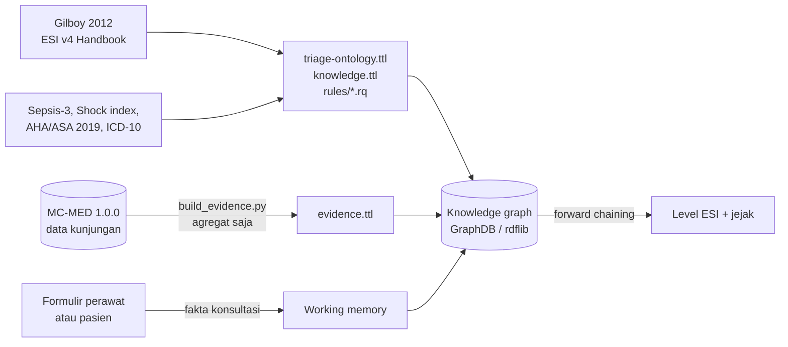

# Data dan Sumber Pengetahuan

Dokumen ini menjelaskan data apa saja yang digunakan sistem pakar **Perlu ke IGD?**, dari mana asalnya, disimpan di berkas mana, dan bagaimana data pasien diperlakukan. Ringkasnya ada empat lapis data:

| Lapis | Isi | Sifat | Berkas |
| --- | --- | --- | --- |
| 1. Sumber pengetahuan | Buku pedoman dan publikasi yang menjadi dasar aturan | Dokumen rujukan, tidak dimuat ke program | Dikutip di setiap aturan (`dcterms:bibliographicCitation`) |
| 2. Basis pengetahuan | Ontologi, konsep klinis, ambang, aturan IF-THEN | Tetap, berlaku untuk semua pasien | `kb/*.ttl`, `kb/rules/*.rq` |
| 3. Bukti empiris | Statistik agregat kunjungan IGD MC-MED | Tetap, angka agregat saja | `kb/evidence.ttl` |
| 4. Fakta konsultasi | Jawaban satu pasien (usia, keluhan, riwayat, tanda vital) | Sementara, dihapus setelah inferensi | Working memory di rdflib atau GraphDB |

---

## 1. Sumber pengetahuan (dokumen pakar)

Aturan tidak dikarang. Setiap aturan menunjuk sumbernya melalui `dcterms:source` (individu `ex:Source`) dan `dcterms:bibliographicCitation` (bab atau tabel). Sumber yang digunakan:

| Individu | Dokumen | Dipakai untuk |
| --- | --- | --- |
| `ex:Src_ESIv4` | Gilboy N, Tanabe P, Travers D, Rosenau AM. *Emergency Severity Index (ESI), Version 4. Implementation Handbook 2012 Edition.* AHRQ 12-0014. Salinan PDF ada di folder bahan *Thesis Preparation*. | Algoritma Decision Point A-D, ambang danger zone per usia, definisi resource, situasi risiko tinggi (Tabel 3-1), demam pada anak, aturan A01-A03, B01-B12, C00-C02, D01, E01, Z01 |
| `ex:Src_Sepsis3` | Singer M, dkk. Sepsis-3. *JAMA* 2016;315(8):801-810. | Aturan F01 (qSOFA) |
| `ex:Src_ShockIndex` | Allgöwer M, Burri C. Schockindex. *Dtsch Med Wochenschr* 1967. | Aturan G01 (peringatan shock index) |
| `ex:Src_AHAStroke` | Powers WJ, dkk. Guidelines for the Early Management of Acute Ischemic Stroke: 2019 Update. *Stroke* 2019;50:e344-e418. | Aturan G02 (jendela trombolisis 4,5 jam) |
| `ex:Src_MCMED` | Kansal A, dkk. MC-MED. *Scientific Data* 2025. | Bukti empiris di `evidence.ttl` |
| (kode, bukan individu) | WHO, ICD-10 | `skos:notation` pada setiap riwayat penyakit, mis. Diabetes = E10-E14 |

Aturan yang ambangnya belum dinyatakan eksplisit di sumber diberi catatan `skos:editorialNote "Perlu validasi pakar klinis"` (B06, B08, B12). Daftar ini sekaligus menjadi daftar periksa untuk tinjauan perawat atau dokter IGD.

## 2. Basis pengetahuan (knowledge graph)

| Berkas | Isi | Jumlah triple |
| --- | --- | --- |
| `kb/triage-ontology.ttl` | TBox v2.2: kelas (kasus, pasien, temuan, riwayat, obat, wilayah tubuh, onset, aturan, pertanyaan, inferensi) dan property beserta domain/range | 298 |
| `kb/knowledge.ttl` | ABox pengetahuan: level ESI, Decision Point, kelompok usia, ambang danger zone, resource, temuan klinis dengan sinonim, riwayat penyakit, obat, penanda risiko, wilayah tubuh, onset, metadata aturan, pertanyaan dialog | 1.032 |
| `kb/evidence.ttl` | Statistik agregat MC-MED (lihat bagian 3) | 44 |
| `kb/shapes.ttl` | SHACL: syarat data kasus dan pasien sebelum inferensi | 75 |
| `kb/rules/*.rq` | 24 aturan IF-THEN dalam bentuk SPARQL `INSERT ... WHERE` | 24 berkas |
| `kb/graphdb/repo-config.ttl` | Konfigurasi repository GraphDB `triage-es` dengan reasoner OWL 2 RL | |

Setelah dimuat ke GraphDB, reasoner OWL 2 RL menambahkan triple turunan: total 3.414 triple (1.374 eksplisit, 2.040 hasil reasoner).

**Isi pengetahuan dalam angka**

| Konsep | Jumlah | Contoh |
| --- | --- | --- |
| Temuan klinis (`ex:Finding`) | 44, dengan 187 sinonim bahasa Indonesia | Distres napas berat, Tanda stroke, Demam |
| Ambang danger zone | 9 individu `ex:DangerZoneThreshold` | Nadi > 100 untuk usia > 8 tahun |
| Resource ESI | 8 resource, 4 non-resource | Laboratorium, CT/USG, Obat IV |
| Riwayat penyakit (`ex:Condition`) | 11, dengan kode ICD-10 | Hipertensi I10, Gagal ginjal N18.6 |
| Golongan obat (`ex:MedicationClass`) | 4 | Pengencer darah, Insulin |
| Penanda risiko (`ex:RiskFlag`) | 6 | Risiko perdarahan, Imunokompromais |
| Wilayah tubuh (`ex:BodyRegion`) | 15, hierarki `skos:broader` | Perut kanan bawah → Perut |
| Kategori onset (`ex:OnsetCategory`) | 5, dengan batas jam | 1 sampai 4,5 jam |
| Aturan (`ex:Rule`) | 24 | A01-A03, B01-B12, C00-C02, D01, E01, F01, G01-G02, Z01 |
| Pertanyaan (`ex:Question`) | 9, masing-masing menunjuk aturan yang membutuhkannya | Q_History → B06, B07, B09, B10, B12 |

**Mengapa riwayat penyakit dibaca melalui penanda risiko.** Aturan B07 tidak menyebut "kanker, transplantasi, HIV, steroid, kemoterapi" satu per satu. Setiap riwayat dan obat diberi `ex:riskFlag`, lalu aturan cukup menanyakan "adakah riwayat atau obat dengan penanda imunokompromais". Menambah penyakit baru cukup dengan menambah satu individu di `knowledge.ttl`, tanpa mengubah aturan.

## 3. Bukti empiris: MC-MED

| Hal | Keterangan |
| --- | --- |
| Dataset | MC-MED 1.0.0 (*Multimodal Clinical Monitoring in the Emergency Department*), Stanford, dirilis melalui PhysioNet |
| Lisensi | PhysioNet *credentialed*: data tingkat kunjungan **tidak boleh** dibagikan ulang |
| Berkas mentah | `data/raw/mc-med-1.0.0/visits.csv` (38 MB, 33 kolom per kunjungan: usia, jenis kelamin, tanda vital triase, ESI perawat, keluhan utama, disposisi, diagnosis ICD-10). Salinan dari `Thesis Preparation/Dataset/mc-med-1.0.0`. Folder `data/` masuk `.gitignore` sehingga tidak pernah ter-commit |
| Pengolahan | `python -I kb/build_evidence.py` (tanpa argumen membaca `data/raw/...`) menghitung agregat per level ESI dan per status danger zone |
| Yang disimpan | Hanya angka agregat di `kb/evidence.ttl`, masing-masing `prov:wasDerivedFrom ex:Src_MCMED` |
| Dipakai untuk | Menampilkan bukti pendukung di hasil, mis. "dari 27.880 kunjungan ESI 2, 49% dirawat inap" |

| Agregat | Kunjungan | Rawat inap atau ICU | Luaran kritis |
| --- | --- | --- | --- |
| ESI 1 | 1.066 | 85,4% | 58,1% |
| ESI 2 | 27.880 | 49,1% | 7,1% |
| ESI 3 | 77.259 | 22,3% | 0,8% |
| ESI 4 | 10.973 | 2,1% | 0,1% |
| ESI 5 | 680 | 1,3% | 0,0% |
| ESI 3-5 dengan danger zone | 17.239 | 29,8% | 1,34% |
| ESI 3-5 tanpa danger zone | 71.673 | 17,2% | 0,60% |

Baris danger zone menunjukkan bahwa pasien ESI 3-5 dengan tanda vital di danger zone lebih sering dirawat inap. Angka ini menjadi alasan empiris aturan E01 (naikkan ke ESI 2). Data kunjungan dari Tugas 4 (`triagekg.ttl`, `triagekg.trig`) juga berasal dari MC-MED dan karena itu juga dikecualikan dari repository.

## 4. Fakta konsultasi (working memory)

Setiap konsultasi membuat graph kecil yang hanya hidup selama inferensi. Pemetaan jawaban ke triple:

| Jawaban | Property di knowledge graph | Diisi oleh | Dibaca aturan |
| --- | --- | --- | --- |
| Usia | `ex:age` / `ex:ageMonths` pada kasus | Perawat, pasien | D01, B04, B05, B08, C02, F01, G01 |
| Keluhan dan tanda bahaya | `ex:presentsWith` → `ex:Finding` | Perawat, pasien | A01, B01, B02, B06, B10, B11, C00 |
| Onset | `ex:onset` → `ex:OnsetCategory`, `ex:onsetSudden` | Perawat, pasien | B11, G02 |
| Skala dan lokasi nyeri | `ex:painScore`, `ex:painSite` → `ex:BodyRegion` | Perawat, pasien | B03, B08, B09, B11, B12 |
| Riwayat penyakit | `ex:ofPatient` / `ex:hasCondition` → `ex:Condition` | Perawat, pasien | B06, B07, B10, B12 |
| Obat | `ex:takesMedication` → `ex:MedicationClass` | Perawat, pasien | B06, B07, B10, B12 |
| Jenis kelamin, kehamilan | `ex:sex`, `ex:pregnancyStatus` pada pasien | Perawat, pasien | B09 |
| Tanda vital | `ex:heartRate`, `ex:respRate`, `ex:o2Sat`, `ex:sbp`, `ex:temperatureC` | Perawat (pasien bila sempat mengukur) | A02, D01, F01, G01, B04, B05, B07 |
| Kesadaran AVPU | `ex:avpu` | Perawat | A03, B02, F01 |
| Perkiraan resource | `ex:needsResource`, `ex:resourcesAssessed` | Perawat; untuk pasien diperkirakan aturan C00 | C01 |
| Sumber data | `ex:reportedByLayperson true` | Otomatis pada mode pasien | C00 |

Riwayat melekat pada node pasien (`ex:Patient`), sedangkan keluhan dan tanda vital melekat pada kasus (`ex:TriageCase`). Pemisahan ini mengikuti kenyataan klinis: satu pasien dapat datang berkali-kali dengan riwayat yang sama tetapi keluhan berbeda.

**Perlakuan data pasien.**
- Tidak ada nama, nomor rekam medis, atau identitas yang ditanyakan. IRI kasus berupa kode acak (`Triase_…`, `Mandiri_…`).
- Di GraphDB, seluruh triple kasus dan inferensinya dihapus begitu hasil dikirim (`DELETE ... FILTER(STRSTARTS(...))` di `app/engine.py`).
- Sesi mode chat disimpan di memori proses dan hilang saat server dimatikan.
- Bila Claude API diaktifkan, hanya teks keluhan bebas yang dikirim untuk dikenali; keputusan tetap dari aturan.

## 5. Data uji

| Berkas | Isi |
| --- | --- |
| `tests/test_rules.py` | 35 kasus emas aturan (termasuk kasus batas: suhu 37,9, usia 64, nadi 100), uji SHACL, uji urutan forward chaining, uji paritas GraphDB = rdflib |
| `tests/test_dialog.py` | Uji percakapan mode chat |
| `tests/test_e2e.py` | 8 skenario Playwright di Chrome: anak demam, tanda bahaya, keluhan ringan, teks bebas, tampilan HP, usia tidak logis, riwayat diabetes, formulir perawat |

Rencana berikutnya (audit V1): kasus latihan resmi Bab 9 dan kompetensi Bab 10 handbook ESI dijadikan data uji emas.

## 6. Dokumen proyek

| Dokumen | Isi |
| --- | --- |
| `00 - Roadmap Sistem Pakar Triase IGD.md` | Rencana pembangunan |
| `01 - Representasi Pengetahuan.md` | Penjelasan ontologi dan knowledge graph sesuai materi kuliah |
| `02 - Penalaran dan Penjelasan.md` | Forward chaining, OWL 2 RL, SHACL, penjelasan HOW dan WHY |
| `03 - Audit Klinis dan Rencana Perbaikan.md` | Temuan audit perawat dan rencana bertahap |
| `04 - Data dan Sumber Pengetahuan.md` | Dokumen ini |
| `docs/Laporan Akhir - Sistem Pakar Triase IGD.pdf` | Laporan akhir (belum memuat perubahan v2.2) |
| `docs/Dokumen Pendukung - Representasi Pengetahuan dan Penalaran.pdf` | Dokumen pendukung materi (belum memuat perubahan v2.2) |
| `deck/*.pptx` | Presentasi kelas dan materi pendukung (belum memuat perubahan v2.2) |
| `README.md` | Instalasi, menjalankan, struktur folder, lisensi data |
