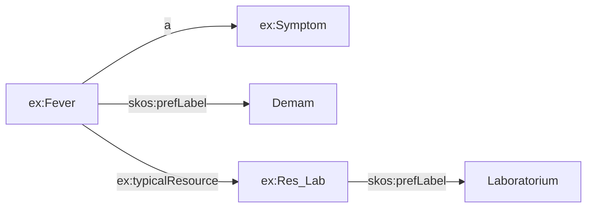
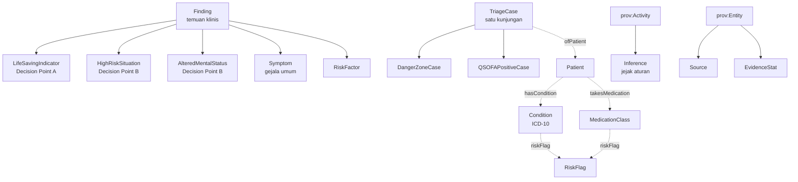
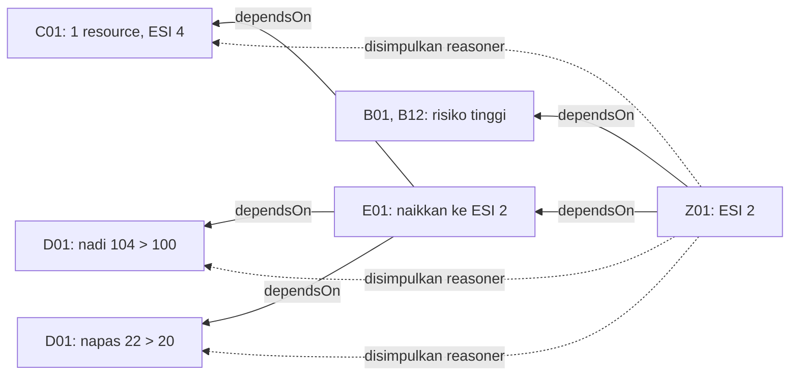

# Memahami Berkas TTL

Panduan ini menjawab tiga pertanyaan:

1. **Apa isi berkas `.ttl`** di folder `kb/`, dan bagaimana cara membacanya.
2. **Informasi apa yang dapat diperoleh** dari knowledge graph ini (dengan contoh pertanyaan dan jawaban aslinya).
3. **Informasi baru apa yang muncul dari TBox**, yaitu fakta yang tidak pernah ditulis tangan tetapi disimpulkan sendiri oleh reasoner.

Semua contoh di bawah diambil dari knowledge graph proyek ini (ontologi v2.2), bukan contoh rekaan.

---

## 1. TTL dalam satu menit

TTL (Turtle) adalah format teks untuk menulis **fakta**. Setiap fakta terdiri dari tiga bagian, mirip kalimat sederhana:

| Bagian | Peran dalam kalimat | Contoh |
| --- | --- | --- |
| Subjek | Siapa atau apa yang dibicarakan | `ex:Fever` (konsep demam) |
| Predikat | Hubungannya | `skos:prefLabel` (bernama) |
| Objek | Nilainya | `"Demam"@id` |

Satu fakta disebut **triple**. Kumpulan triple yang saling terhubung membentuk **graph**: subjek dan objek menjadi simpul, predikat menjadi garis penghubung.



### Cara membaca satu baris

```turtle
ex:Fever a ex:Symptom ; ex:bodySystem ex:Sys_General ; skos:prefLabel "Demam"@id ;
    skos:altLabel "demam"@id , "panas"@id , "meriang"@id .
```

| Tanda | Arti | Pada contoh |
| --- | --- | --- |
| `ex:` | Singkatan alamat (prefix). `ex:Fever` = `http://example.org/triage/Fever` | Semua nama milik proyek ini |
| `a` | Singkatan "adalah anggota kelas" (`rdf:type`) | Demam adalah sebuah Gejala |
| `;` | Subjek yang sama, predikat baru | Demam ... ; sistem organnya ... ; namanya ... |
| `,` | Subjek dan predikat sama, objek tambahan | Sinonimnya demam, panas, meriang |
| `.` | Akhir pernyataan untuk subjek ini | |
| `"..."@id` | Teks berbahasa Indonesia | `"Demam"@id` |
| `"..."^^xsd:decimal` atau angka polos | Nilai angka | `ex:limit 100.0` |
| `#` | Komentar, diabaikan mesin | `# Ambang danger zone ...` |

Dengan demikian, baris di atas berisi **enam triple**: Demam adalah Gejala, sistem organnya Penyakit dalam umum, nama resminya "Demam", dan sinonimnya "demam", "panas", "meriang".

---

## 2. Peta berkas di folder `kb/`

| Berkas | Analogi | Isi | Triple |
| --- | --- | --- | --- |
| `triage-ontology.ttl` | **Kamus dan tata bahasa** (TBox) | Jenis-jenis benda (kelas) dan jenis hubungan (property) beserta aturannya: domain, range, subkelas, transitif | 298 |
| `knowledge.ttl` | **Isi buku pedoman** (ABox pengetahuan) | Konsep klinis nyata: level ESI, ambang danger zone, 44 temuan, riwayat penyakit, obat, wilayah tubuh, metadata 24 aturan, pertanyaan | 1.033 |
| `evidence.ttl` | **Lampiran statistik** | Angka agregat MC-MED per level ESI | 44 |
| `shapes.ttl` | **Petugas pemeriksa formulir** (SHACL) | Syarat data kasus: usia wajib, nadi 0-300, riwayat harus individu `ex:Condition` | 75 |
| `rules/*.rq` | **Pasal IF-THEN** | 24 aturan triase dalam SPARQL `INSERT ... WHERE` | 24 berkas |

**TBox dan ABox.** Istilah dari materi *Knowledge Representation*:
- **TBox** (*terminological box*) mendefinisikan **istilah**: "Gejala adalah sejenis Temuan", "hasCondition menghubungkan Pasien dengan Riwayat penyakit".
- **ABox** (*assertional box*) berisi **pernyataan tentang benda nyata**: "Demam adalah Gejala", "Diabetes memiliki penanda risiko metabolik".

TBox tidak menyebut satu pun pasien atau penyakit tertentu. ABox tidak mendefinisikan istilah baru. Keduanya digabung di GraphDB, lalu reasoner membaca TBox untuk menambah fakta pada ABox.

---

## 3. Isi TBox (`triage-ontology.ttl`)

### 3.1 Kelas utama



Garis tegas = "adalah sejenis" (`rdfs:subClassOf`). Garis putus-putus = property yang menghubungkan dua kelas.

### 3.2 Jenis aksioma dan artinya

Setiap aksioma TBox adalah satu "hukum" yang dipegang reasoner. Tabel ini menjelaskan artinya dalam bahasa sehari-hari dan informasi baru yang dihasilkannya.

| Aksioma | Arti sehari-hari | Contoh di proyek | Informasi baru yang dihasilkan |
| --- | --- | --- | --- |
| `rdfs:subClassOf` | "Setiap A pasti juga B" | `ex:Symptom rdfs:subClassOf ex:Finding` | Demam (Symptom) otomatis tercatat sebagai Finding |
| `rdfs:subPropertyOf` | "Hubungan A adalah bentuk khusus hubungan B" | `ex:heartRate rdfs:subPropertyOf ex:vitalValue` | Nadi 104 otomatis tercatat sebagai salah satu nilai tanda vital |
| `rdfs:domain` | "Yang memiliki hubungan ini pasti anggota kelas X" | `ex:presentsWith rdfs:domain ex:TriageCase` | Apa pun yang "mengeluhkan sesuatu" pasti sebuah kasus triase |
| `rdfs:range` | "Yang dituju hubungan ini pasti anggota kelas Y" | `ex:hasCondition rdfs:range ex:Condition` | Apa pun yang dicatat sebagai riwayat pasti sebuah Condition |
| `owl:TransitiveProperty` | "Bila A ke B dan B ke C, maka A ke C" | `ex:moreAcuteThan`, `ex:dependsOn` | ESI 1 lebih akut dari ESI 5, walau hanya ditulis ESI 1 > 2 > 3 > 4 > 5 |
| `owl:equivalentClass` | "A dan B adalah kelas yang sama dengan nama berbeda" | `ex:EDVisit owl:equivalentClass ex:TriageCase` | Data kunjungan Tugas 4 (EDVisit) terbaca sebagai kasus triase, dan sebaliknya |
| `owl:FunctionalProperty` | "Paling banyak satu nilai" | `ex:recommendedESI`, `ex:ofPatient`, `ex:onset` | Bila satu kasus mendapat dua rekomendasi berbeda, reasoner menyimpulkan keduanya sama (tanda ada yang salah) |
| `owl:disjointWith` | "Tidak mungkin sekaligus A dan B" | `ex:HighRiskSituation owl:disjointWith ex:Symptom` | Bila satu temuan dicatat sebagai keduanya, knowledge graph tidak konsisten (kesalahan terdeteksi) |

---

## 4. Informasi baru dari TBox (hasil reasoner)

Reasoner OWL 2 RL di GraphDB membaca aksioma di atas lalu **menambahkan triple sendiri**. Angka dari repository `triage-es`:

| | Triple |
| --- | --- |
| Ditulis tangan (eksplisit) | 1.375 |
| Disimpulkan reasoner | 2.040 |
| Total | 3.415 |

Sebagian besar hasil reasoner bersifat teknis (mis. setiap benda adalah `owl:Thing`, setiap benda sama dengan dirinya sendiri). Yang bermakna untuk triase dijelaskan di bawah.

### 4.1 Pada tingkat pengetahuan (berlaku untuk semua pasien)

**a. Urutan keakutan lengkap.** Di `knowledge.ttl` hanya ditulis empat langkah: ESI 1 > ESI 2, ESI 2 > ESI 3, ESI 3 > ESI 4, ESI 4 > ESI 5. Karena `ex:moreAcuteThan` transitif, reasoner menambahkan enam fakta:

| Disimpulkan | Dari |
| --- | --- |
| ESI 1 lebih akut dari ESI 3, ESI 4, ESI 5 | Rantai 1 > 2 > 3 > 4 > 5 |
| ESI 2 lebih akut dari ESI 4, ESI 5 | Rantai 2 > 3 > 4 > 5 |
| ESI 3 lebih akut dari ESI 5 | Rantai 3 > 4 > 5 |

Manfaatnya: query "level apa saja yang lebih gawat dari ESI 3?" langsung dijawab "ESI 1 dan ESI 2" tanpa program tambahan.

**b. Semua 44 temuan dikenali sebagai `ex:Finding`.** Di `knowledge.ttl` setiap temuan hanya ditulis sebagai subkelasnya (Symptom, HighRiskSituation, dan seterusnya). Reasoner menurunkan bahwa semuanya juga Finding. Inilah sebabnya validasi API (`lexicon('Finding')`) cukup menanyakan satu kelas.

**c. Sumber dan bukti menjadi entitas PROV-O.** Lima `ex:Source` dan tujuh `ex:EvidenceStat` otomatis menjadi `prov:Entity` (12 triple). Alat lain yang memahami standar PROV-O langsung dapat membaca asal-usul pengetahuan tanpa mengenal kosakata `ex:`.

### 4.2 Pada tingkat kasus (setiap konsultasi)

Contoh nyata: pasien 58 tahun, nyeri dada, riwayat hipertensi, minum pengencer darah, nyeri di dada, nadi 104, napas 22, TD 165. Working memory berisi **13 triple** yang ditulis aplikasi. Setelah aturan dan reasoner berjalan, GraphDB mencatat 97 triple untuk kasus ini: 64 eksplisit (13 jawaban + hasil aturan) dan **33 hasil reasoner**. Contoh yang bermakna:

| Fakta baru dari reasoner | Aksioma TBox penyebabnya | Kegunaan |
| --- | --- | --- |
| `:Contoh a :EDVisit` | `EDVisit owl:equivalentClass TriageCase` | Kasus baru dapat dibandingkan dengan 118 ribu kunjungan MC-MED dari Tugas 4 dalam satu query |
| `:Contoh a :DangerZoneVisit` | `DangerZoneVisit owl:equivalentClass DangerZoneCase` (D01 menulis DangerZoneCase) | Sama: masuk kelompok danger zone pada data historis |
| `:Contoh :vitalValue 104`, `165`, `22` | `heartRate`, `sbp`, `respRate` adalah `subPropertyOf vitalValue` | Satu query "ambil semua tanda vital" tanpa menyebut satu per satu |
| `:Contoh_inf_B12_... a prov:Activity` (7 node) | `ex:Inference rdfs:subClassOf prov:Activity` | Jejak penalaran sesuai standar W3C PROV |
| `:Contoh_inf_Z01 :dependsOn :Contoh_inf_C01`, `..._D01_DZ_HR_8y_up`, `..._D01_DZ_RR_8y_up` | `ex:dependsOn` transitif | Penjelasan HOW lengkap: Z01 bergantung pada E01, dan E01 bergantung pada C01 serta D01, sehingga Z01 juga bergantung pada keduanya |

Butir terakhir adalah yang paling penting untuk fasilitas penjelasan. Aturan Z01 hanya mencatat aturan yang langsung menyimpulkan ESI 2 (B01, B12, E01). Reasoner melengkapi rantainya, sehingga panel "Jejak aturan" dapat menampilkan seluruh dasar keputusan sampai ke data nadi dan napas.



### 4.3 Yang TIDAK dihasilkan TBox

TBox hanya menurunkan fakta yang **pasti benar secara logika** dari definisi. TBox tidak dapat memutuskan "pasien ini ESI 2". Pembagian tugasnya:

| Komponen | Pertanyaan yang dijawab | Contoh |
| --- | --- | --- |
| Reasoner TBox (OWL 2 RL) | "Apa yang pasti benar menurut definisi istilah?" | Kasus ini juga EDVisit; ESI 1 lebih akut dari ESI 5 |
| Aturan SPARQL (`rules/*.rq`) | "Apa kesimpulan klinisnya menurut pedoman?" | Nadi 104 pada dewasa = danger zone; nyeri dada + hipertensi = kandidat ESI 2 |
| SHACL (`shapes.ttl`) | "Apakah datanya lengkap dan masuk akal?" | Usia wajib ada; nadi 400 ditolak |

### 4.4 Catatan penting: dunia terbuka

OWL menganut asumsi **dunia terbuka**: yang tidak tercatat dianggap "belum diketahui", bukan "salah". Akibatnya `rdfs:range` **tidak menolak** data yang keliru, melainkan menyimpulkan.

Contoh dari pengujian proyek ini: bila aplikasi keliru mengirim "Demam" sebagai riwayat penyakit (`hasCondition ex:Fever`), reasoner tidak protes. Ia justru menyimpulkan "Demam adalah sebuah Condition". Karena itu proyek ini memakai SHACL tanpa inferensi (dunia tertutup) untuk menolak data semacam itu sebelum penalaran (`tests/test_rules.py::test_shacl_case_graph_valid`).

---

## 5. Isi ABox (`knowledge.ttl`) per bagian

| Bagian | Contoh triple | Jumlah |
| --- | --- | --- |
| Sumber pengetahuan | `ex:Src_ESIv4 a ex:Source ; rdfs:label "Gilboy N, ..."` | 5 |
| Level ESI dan urutannya | `ex:ESI_2 ex:levelNumber 2 ; ex:moreAcuteThan ex:ESI_3` | 5 |
| Decision Point A-D | `ex:DP_A ex:conclusionIfYes ex:ESI_1 ; ex:nextIfNo ex:DP_B` | 4 |
| Kelompok usia | `ex:Age_3m_3y ex:minMonths 3 ; ex:maxMonths 36` | 7 |
| Ambang danger zone | `ex:DZ_HR_8y_up ex:onVital ex:HR ; ex:comparator "gt" ; ex:limit 100.0` | 9 |
| Resource | `ex:Res_Lab a ex:Resource ; ex:resourceWeight 1` | 8 + 4 non-resource |
| Temuan klinis + sinonim | `ex:StrokeSigns a ex:HighRiskSituation ; skos:altLabel "bicara pelo"@id` | 44 temuan, 187 sinonim |
| Riwayat penyakit | `ex:Cond_Diabetes skos:notation "E10-E14" ; ex:riskFlag ex:Risk_Metabolic` | 11 |
| Golongan obat | `ex:Med_Anticoagulant ex:riskFlag ex:Risk_Bleeding` | 4 |
| Wilayah tubuh | `ex:Region_RLQ skos:broader ex:Region_Abdomen` | 15 |
| Onset | `ex:Onset_1to4h ex:maxHours 4.5` | 5 |
| Aturan | `ex:Rule_B10 ex:ifText "..." ; ex:sparqlFile "rules/B10_muntah_diabetes.rq"` | 24 |
| Pertanyaan | `ex:Q_History ex:neededBy ex:Rule_B06 , ex:Rule_B07 , ...` | 9 |

Prinsip penting: **pengetahuan disimpan sebagai data, bukan ditulis di program.** Ambang nadi 100 tidak ada di kode Python; ia ada di `ex:DZ_HR_8y_up ex:limit 100.0`. Mengubah ambang cukup dengan mengubah satu angka di TTL.

---

## 6. Informasi yang dapat diperoleh (contoh query dan jawaban asli)

Semua query di bawah dapat dijalankan di GraphDB Workbench (lihat bagian 7). Prefix yang diperlukan:

```sparql
PREFIX ex: <http://example.org/triage/>
PREFIX rdfs: <http://www.w3.org/2000/01/rdf-schema#>
PREFIX skos: <http://www.w3.org/2004/02/skos/core#>
PREFIX dcterms: <http://purl.org/dc/terms/>
```

**1. Riwayat atau obat apa saja yang membuat pasien dianggap imunokompromais?**

```sparql
SELECT ?label WHERE { ?x ex:riskFlag ex:Risk_Immunocompromised ; skos:prefLabel ?label }
```

Jawaban: Kanker yang sedang diobati, Transplantasi organ, HIV atau gangguan kekebalan tubuh, Steroid jangka panjang, Kemoterapi atau obat penekan imun. Kelima hal ini yang memicu aturan B07 bila pasien demam.

**2. Berapa batas aman tanda vital anak usia 2 tahun (24 bulan)?**

```sparql
SELECT ?vital ?cmp ?lim WHERE {
  ?t a ex:DangerZoneThreshold ; ex:forAgeGroup ?ag ; ex:onVital/rdfs:label ?vital ;
     ex:comparator ?cmp ; ex:limit ?lim .
  ?ag ex:minMonths ?a ; ex:maxMonths ?b . FILTER(24 >= ?a && 24 < ?b) }
```

Jawaban: nadi > 160, napas > 40, SpO2 < 92 termasuk danger zone.

**3. Wilayah mana saja yang termasuk "perut"?** (memanfaatkan hierarki `skos:broader`)

```sparql
SELECT ?label WHERE { ?r skos:broader* ex:Region_Abdomen ; skos:prefLabel ?label }
```

Jawaban: Perut (seluruh), Ulu hati, Perut kanan atas, Perut kiri atas, Sekitar pusar, Perut kanan bawah, Perut kiri bawah, Perut bawah/panggul/kelamin. Inilah sebabnya aturan B08 dan B09 terpicu walau perawat hanya memilih "Perut kanan bawah".

**4. Mengapa sistem menanyakan usia?** (penjelasan WHY)

```sparql
SELECT ?id ?if WHERE { ex:Q_Age ex:neededBy ?r . ?r ex:ruleId ?id ; ex:ifText ?if } ORDER BY ?id
```

Jawaban: karena dibutuhkan aturan B04, B05 (bayi demam), B08 (nyeri perut lansia), C02 (anak demam), D01 (danger zone per usia), dan F01 (qSOFA dewasa).

**5. Level apa saja yang lebih gawat dari ESI 3?** (memanfaatkan hasil reasoner, bagian 4.1a)

```sparql
SELECT ?l WHERE { ?e ex:moreAcuteThan ex:ESI_3 ; rdfs:label ?l }
```

Jawaban: ESI 1 (Resusitasi) dan ESI 2 (Gawat). Tanpa reasoner, hanya ESI 2 yang muncul.

**6. Situasi risiko tinggi paling banyak berasal dari sistem organ apa?**

```sparql
SELECT ?sys (COUNT(?f) AS ?n) WHERE {
  ?f a ex:HighRiskSituation ; ex:bodySystem/rdfs:label ?sys } GROUP BY ?sys ORDER BY DESC(?n)
```

Jawaban (empat teratas): Penyakit dalam umum 4, Neurologi 3, Trauma 3, Kardiovaskular 2.

**7. Seberapa sering pasien ESI 2 dirawat inap?** (bukti empiris)

```sparql
SELECT ?visits ?admit WHERE { ?s ex:aboutLevel ex:ESI_2 ; ex:visits ?visits ; ex:admitRate ?admit }
```

Jawaban: 27.880 kunjungan, 49,1% dirawat inap atau ICU.

**8. Aturan mana yang bersumber dari pedoman stroke AHA/ASA?**

```sparql
SELECT ?id ?cite WHERE { ?r ex:ruleId ?id ; dcterms:bibliographicCitation ?cite ; dcterms:source ex:Src_AHAStroke }
```

Jawaban: G02, "Powers 2019 (AHA/ASA), jendela alteplase 4,5 jam".

---

## 7. Mencoba sendiri

### Di GraphDB Workbench

1. Pastikan container berjalan: `docker start graphdb11`.
2. Buka http://localhost:7201, pilih repository **triage-es** di kanan atas.
3. Menu **SPARQL**, tempel salah satu query di bagian 6, klik **Run**.
4. Untuk melihat peran reasoner, klik ikon **Include inferred data in results** (ikon dua lingkaran) sehingga mati, lalu jalankan ulang query nomor 5. Hasilnya berkurang menjadi hanya ESI 2. Aktifkan kembali untuk melihat hasil lengkap.
5. Menu **Explore → Visual graph**, ketik `ex:ESI_1` atau `http://example.org/triage/Cond_Diabetes` untuk melihat simpul dan hubungannya secara visual.

### Di Python (tanpa GraphDB)

```python
from app import engine
g = engine.knowledge_base()          # ontologi + pengetahuan + bukti, sudah melalui reasoner OWL 2 RL
for row in g.query(engine.PREFIX + 'SELECT ?l WHERE { ?e ex:moreAcuteThan ex:ESI_3 ; rdfs:label ?l }'):
    print(row.l)
```

### Di aplikasi

Buka http://localhost:8000, selesaikan satu triase, lalu klik **Detail teknis sistem pakar**. Tab *Siklus inferensi* menandai triple hasil reasoner dengan label "reasoner".

---

## 8. Glosarium

| Istilah | Arti |
| --- | --- |
| Triple | Satu fakta: subjek, predikat, objek |
| IRI | Alamat unik sebuah benda, mis. `http://example.org/triage/Fever` |
| Prefix | Singkatan IRI, mis. `ex:` |
| Kelas | Kelompok benda sejenis, mis. `ex:Symptom` |
| Individu | Satu benda nyata, mis. `ex:Fever` |
| Property | Jenis hubungan, mis. `ex:hasCondition` |
| Literal | Nilai teks atau angka, mis. `"Demam"@id`, `100.0` |
| TBox | Definisi istilah (kelas, property, aksioma) |
| ABox | Pernyataan tentang individu |
| Reasoner | Program yang menurunkan fakta baru dari aksioma TBox |
| OWL 2 RL | Profil OWL yang dapat dihitung dengan aturan; digunakan GraphDB |
| SKOS | Kosakata untuk label, sinonim, dan hierarki istilah (`prefLabel`, `altLabel`, `broader`) |
| PROV-O | Standar W3C untuk mencatat asal-usul (sumber, aktivitas) |
| SHACL | Bahasa untuk memeriksa bentuk dan kelengkapan data |
| Working memory | Graph kecil berisi fakta satu konsultasi; dihapus setelah selesai |
| Dunia terbuka | Yang tidak tercatat dianggap belum diketahui, bukan salah |
