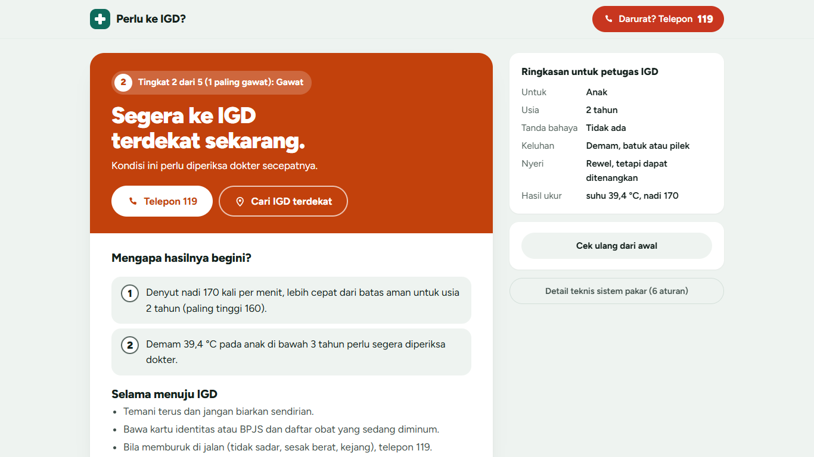

# Perlu ke IGD? · Sistem Pakar Triase IGD

Chatbot tanya-jawab untuk orang awam (pasien atau keluarga) yang menilai tingkat kegawatan dengan **sistem pakar**: knowledge graph OWL/RDF di GraphDB, 16 aturan IF-THEN dari Emergency Severity Index (ESI) versi 4, dan penalaran *forward chaining* yang setiap kesimpulannya dapat ditelusuri.

Project akhir mata kuliah **Sistem Pakar Lanjut**, Magister Kecerdasan Artifisial, FMIPA Universitas Gadjah Mada.

> [!IMPORTANT]
> Aplikasi ini untuk tujuan pendidikan. Hasilnya bukan diagnosis dan belum divalidasi pakar klinis. Dalam keadaan darurat, telepon **119** atau segera ke IGD terdekat.



## Komponen sistem pakar

| Komponen wajib | Implementasi | Lokasi |
| --- | --- | --- |
| Representasi pengetahuan | Ontologi OWL (TBox) + knowledge graph RDF: konsep klinis, ambang danger zone, resource, sinonim, pertanyaan dialog, aturan | `kb/triage-ontology.ttl`, `kb/knowledge.ttl`, `kb/evidence.ttl` |
| Aturan dari pakar | 16 aturan IF-THEN (SPARQL `INSERT`), bersumber dari Gilboy dkk. *ESI v4 Implementation Handbook* (2012), Sepsis-3 (Singer 2016), dan shock index (Allgöwer & Burri 1967) | `kb/rules/*.rq` |
| Penalaran + penjelasan | Forward chaining sampai titik tetap + reasoner OWL 2 RL GraphDB; jejak `ex:Inference` (PROV-O) untuk penjelasan HOW dan WHY | `app/engine.py` |
| Metode lain (opsional) | Claude API untuk mengenali keluhan teks bebas dan menulis narasi; level ESI tetap diputuskan aturan | `app/llm.py` |

Penjelasan lengkap: [Representasi Pengetahuan](<01 - Representasi Pengetahuan.md>) dan [Penalaran dan Penjelasan](<02 - Penalaran dan Penjelasan.md>).

## Instalasi

### Prasyarat

- Python 3.10 atau lebih baru
- Google Chrome (untuk uji end-to-end Playwright)
- Docker Desktop (opsional, untuk GraphDB; tanpa GraphDB aplikasi memakai rdflib in-memory)
- Node.js 18+ (opsional, hanya untuk membangun ulang PPT di `deck/`)

### 1. Siapkan Python

```powershell
python -m venv .venv
.venv\Scripts\activate
pip install -r requirements.txt
```

Di macOS/Linux, aktifkan dengan `source .venv/bin/activate`.

### 2. Jalankan GraphDB (opsional, direkomendasikan)

```powershell
docker run -d --name graphdb11 -p 7201:7200 ontotext/graphdb:11.5.2
```

Tunggu sekitar 30 detik sampai GraphDB siap di http://127.0.0.1:7201, lalu buat repository `triage-es` dan muat knowledge base:

```powershell
python -m app.graphdb
```

Keluaran yang diharapkan: tiga graph dimuat (`graph/tbox`, `graph/pengetahuan`, `graph/bukti`) dan jumlah triple eksplisit serta hasil reasoner OWL 2 RL.

### 3. Jalankan aplikasi

```powershell
uvicorn app.main:app --port 8000
```

Buka http://localhost:8000. Tambahkan `?presentasi` untuk langsung membuka panel detail teknis (untuk kuliah).

### 4. Aktifkan Claude API (opsional)

```powershell
$env:ANTHROPIC_API_KEY = "sk-ant-..."
uvicorn app.main:app --port 8000
```

Tanpa kunci, aplikasi berjalan penuh dalam mode lokal. Model dapat diganti dengan `CLAUDE_MODEL` (bawaan `claude-opus-5-5`).

### Variabel lingkungan

| Variabel | Bawaan | Fungsi |
| --- | --- | --- |
| `KG_BACKEND` | `auto` | `graphdb`, `rdflib`, atau `auto` (GraphDB bila repository aktif) |
| `GRAPHDB_URL` | `http://127.0.0.1:7201` | Alamat GraphDB |
| `GRAPHDB_REPO` | `triage-es` | Nama repository |
| `LLM_ENABLED` | `1` | `0` untuk mematikan Claude API |
| `ANTHROPIC_API_KEY` | | Kunci Claude API |

## Pengujian

```powershell
python -m pytest -q
```

52 tes: 23 kasus emas aturan (termasuk kasus batas ambang), 8 uji paritas GraphDB = rdflib (dilewati bila GraphDB tidak aktif), uji dialog, uji SHACL, dan 6 uji end-to-end Playwright di Chrome yang terpasang (`pytest.ini` memakai `--browser-channel chrome`).

Tangkapan layar semua tahap di ukuran laptop dan HP (server harus berjalan):

```powershell
python tools/capture.py
```

## Struktur folder

```text
app/        backend FastAPI: engine.py (mesin inferensi), graphdb.py, dialog.py, nlu.py, llm.py, main.py
kb/         knowledge base: ontologi, pengetahuan, bukti MC-MED agregat, SHACL, rules/*.rq, graphdb/repo-config.ttl
web/        antarmuka statis (index.html, app.css, app.js)
tests/      pytest: aturan, dialog, end-to-end Playwright
tools/      capture.py (tangkapan layar untuk audit dan presentasi)
deck/       pembangun PPT (pptxgenjs) dan file presentasi
docs/       tangkapan layar
.claude/    agent ux-auditor dan skill ui-audit untuk audit tampilan
```

## API

| Metode | Path | Fungsi |
| --- | --- | --- |
| POST | `/api/assess` | Fakta terstruktur (usia, temuan, nyeri, tanda vital) → level ESI, saran, jejak penalaran |
| POST | `/api/parse` | Keluhan teks bebas → ID temuan di knowledge graph |
| POST | `/api/session`, `/api/chat` | Dialog percakapan (mode perawat) |
| GET | `/api/rules` | Katalog aturan beserta sumbernya |
| GET | `/api/findings` | Daftar temuan klinis |
| GET | `/api/health` | Jumlah triple, aturan, backend, status LLM |

## Data dan lisensi

- Statistik di `kb/evidence.ttl` adalah **angka agregat** dari MC-MED 1.0.0 (Kansal dkk., *Scientific Data* 2025). Data tingkat kunjungan berlisensi PhysioNet *credentialed* dan **tidak** disertakan di repository ini; skrip `kb/build_evidence.py` menghitung ulang agregat bila Anda memiliki akses.
- Aturan triase mengacu pada Gilboy N, Tanabe P, Travers D, Rosenau AM. *Emergency Severity Index (ESI): A Triage Tool for Emergency Department Care, Version 4*. AHRQ Publication No. 12-0014, 2011.
