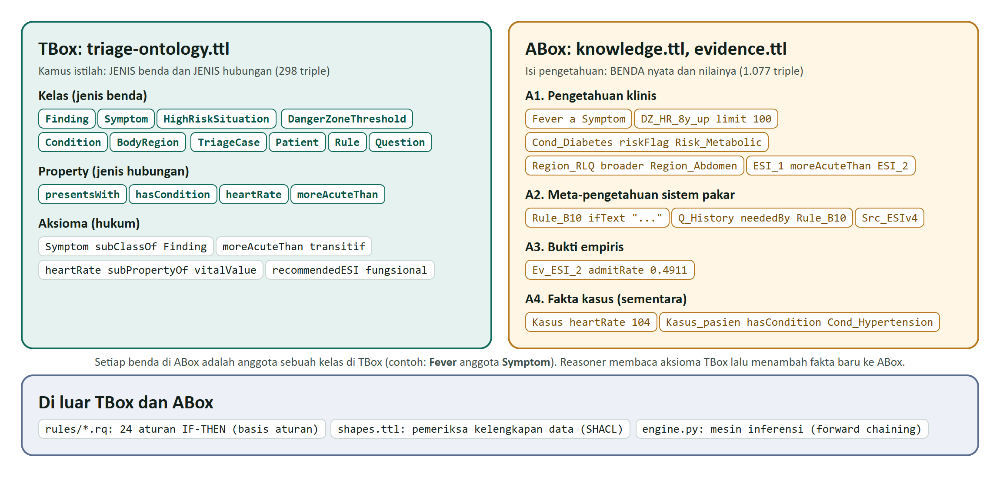
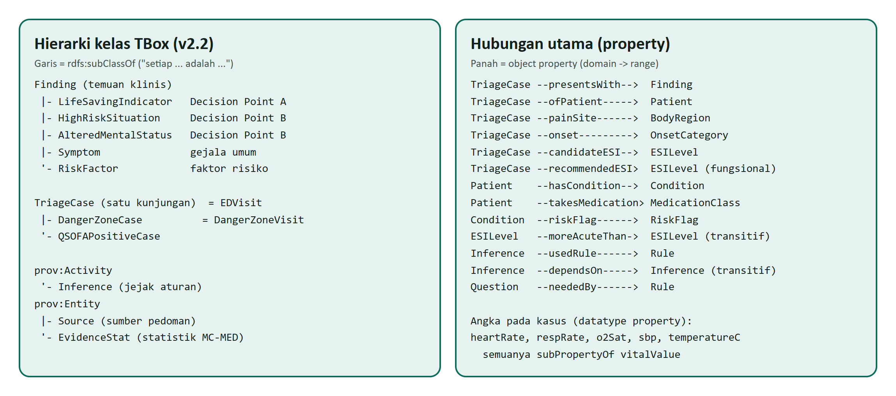
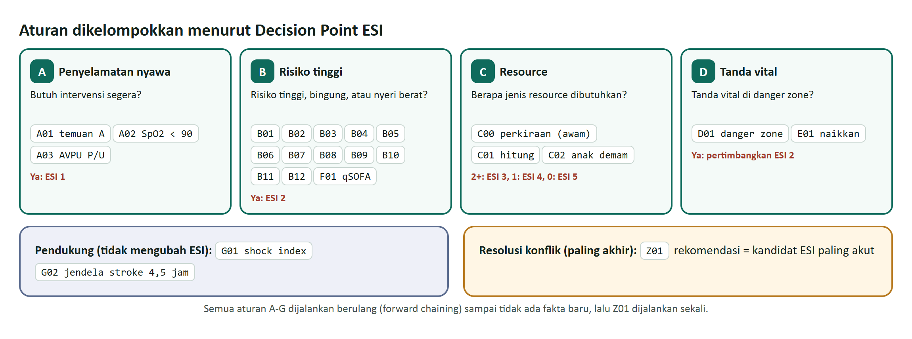

# 1. Pengantar

## 1.1 Tujuan bahan ajar

Setelah mempelajari bahan ajar ini, pembaca diharapkan dapat:

1. Membaca berkas Turtle (`.ttl`) dan memahami arti setiap baris.
2. Membedakan **TBox** dan **ABox**, beserta alasan sebuah pernyataan termasuk salah satunya.
3. Menjelaskan peran TBox, ABox, dan aturan bagi aplikasi sistem pakar triase IGD *Perlu ke IGD?*.
4. Membaca aturan IF-THEN dalam bentuk SPARQL dan menelusuri cara mesin inferensi menjalankannya.
5. Menelusuri satu kasus pasien dari jawaban formulir sampai keputusan level ESI beserta penjelasannya.

Semua contoh diambil dari kode proyek (ontologi versi 2.2), bukan contoh rekaan. Nama berkas dan fungsi ditulis lengkap agar dapat dibuka dan dicocokkan langsung.

## 1.2 Tiga blok sistem pakar

Sistem pakar terdiri dari tiga blok. Bahan ajar ini membahas ketiganya dari sisi kode.

| Blok | Pertanyaan yang dijawab | Wujud di proyek |
| --- | --- | --- |
| Basis pengetahuan | Apa yang diketahui pakar? | TBox (`kb/triage-ontology.ttl`) dan ABox (`kb/knowledge.ttl`, `kb/evidence.ttl`) |
| Basis aturan | Bagaimana pakar menarik kesimpulan? | 24 aturan SPARQL di `kb/rules/*.rq` |
| Mesin inferensi dan penjelasan | Bagaimana kesimpulan dihitung dan dijelaskan? | `app/engine.py` (forward chaining), reasoner OWL 2 RL di GraphDB |



## 1.3 Peta berkas

| Berkas | Kelompok | Jumlah triple | Fungsi bagi aplikasi |
| --- | --- | --- | --- |
| `kb/triage-ontology.ttl` | TBox | 298 | Mendefinisikan jenis benda dan hubungan; dibaca reasoner |
| `kb/knowledge.ttl` | ABox | 1.033 | Isi pengetahuan klinis dan kartu aturan; dibaca aturan dan antarmuka |
| `kb/evidence.ttl` | ABox | 44 | Statistik MC-MED yang ditampilkan sebagai bukti |
| `kb/shapes.ttl` | Validasi (SHACL) | 75 | Memeriksa kelengkapan data kasus |
| `kb/rules/*.rq` | Basis aturan | 24 berkas | Logika IF-THEN |
| Working memory | ABox sementara | 13-100 per kasus | Fakta satu konsultasi; dihapus setelah selesai |

Pemeriksaan otomatis terhadap setiap triple menunjukkan pembagian yang bersih: seluruh `triage-ontology.ttl` adalah TBox, sedangkan seluruh `knowledge.ttl` dan `evidence.ttl` adalah ABox.

# 2. Membaca Berkas Turtle

## 2.1 Triple: satuan terkecil pengetahuan

Setiap fakta di knowledge graph berbentuk **triple**, yaitu tiga bagian yang mirip kalimat sederhana:

| Bagian | Peran | Contoh |
| --- | --- | --- |
| Subjek | Yang dibicarakan | `ex:Fever` |
| Predikat | Hubungannya | `skos:prefLabel` |
| Objek | Nilainya | `"Demam"@id` |

Kumpulan triple membentuk **graph**: subjek dan objek menjadi simpul, predikat menjadi garis penghubung.

## 2.2 Membaca satu baris

Contoh dari `kb/knowledge.ttl`:

```turtle
ex:Fever a ex:Symptom ; ex:bodySystem ex:Sys_General ; skos:prefLabel "Demam"@id ;
    skos:altLabel "demam"@id , "panas"@id , "meriang"@id .
```

| Tanda | Arti |
| --- | --- |
| `ex:` | Singkatan alamat. `ex:Fever` berarti `http://example.org/triage/Fever` |
| `a` | "adalah anggota kelas" (singkatan `rdf:type`) |
| `;` | Subjek sama, predikat baru |
| `,` | Subjek dan predikat sama, objek tambahan |
| `.` | Akhir pernyataan untuk subjek ini |
| `"..."@id` | Teks berbahasa Indonesia |
| `#` | Komentar, diabaikan mesin |

Baris di atas berisi enam triple: Demam adalah Gejala; sistem organnya Penyakit dalam umum; nama resminya "Demam"; sinonimnya "demam", "panas", dan "meriang".

# 3. TBox: Kamus Istilah

## 3.1 Pengertian

**TBox** (*terminological box*) mendefinisikan **istilah**: jenis benda apa saja yang ada (kelas), jenis hubungan apa saja yang ada (property), dan hukum yang berlaku di antara keduanya (aksioma). TBox tidak menyebut satu pun pasien, penyakit, atau angka tertentu.

Analogi: TBox adalah **kamus dan tata bahasa**. Kamus menjelaskan bahwa "gejala" adalah sejenis "temuan klinis", tetapi tidak menyebut gejala apa saja yang ada.

## 3.2 Cara mengenali TBox

Uji sederhana: **lihat subjek triple-nya**.

| Bila subjeknya | Maka triple itu | Contoh |
| --- | --- | --- |
| Sebuah kelas atau property | TBox | `ex:Symptom rdfs:subClassOf ex:Finding` |
| Sebuah benda tertentu | ABox | `ex:Fever a ex:Symptom` |

Kata kunci yang hampir selalu menandai TBox: `owl:Class`, `owl:ObjectProperty`, `owl:DatatypeProperty`, `rdfs:subClassOf`, `rdfs:subPropertyOf`, `rdfs:domain`, `rdfs:range`, `owl:TransitiveProperty`, `owl:FunctionalProperty`, `owl:equivalentClass`, `owl:disjointWith`. Tidak satu pun kata kunci ini muncul di `knowledge.ttl`.

## 3.3 Isi TBox proyek



Kelas dikelompokkan menurut perannya:

| Kelompok kelas | Kelas | Peran |
| --- | --- | --- |
| Pengetahuan klinis | `ESILevel`, `DecisionPoint`, `AgeGroup`, `VitalSign`, `DangerZoneThreshold`, `Resource`, `NonResource`, `BodySystem`, `Finding` dan 5 subkelasnya | Jenis-jenis isi buku pedoman ESI |
| Model pasien (v2.2) | `Patient`, `Condition`, `MedicationClass`, `RiskFlag`, `PregnancyStatus`, `Sex`, `BodyRegion`, `OnsetCategory` | Jenis-jenis informasi anamnesis |
| Kasus | `TriageCase`, `DangerZoneCase`, `QSOFAPositiveCase` | Satu konsultasi dan kelas turunannya |
| Meta sistem pakar | `Rule`, `Question`, `Source`, `Alert`, `Inference` | Aturan, pertanyaan, sumber, dan jejak penalaran |
| Bukti | `EvidenceStat` | Statistik data empiris |

Contoh definisi dari `kb/triage-ontology.ttl`:

```turtle
ex:Finding a owl:Class ; rdfs:label "Temuan klinis"@id .
ex:HighRiskSituation a owl:Class ; rdfs:subClassOf ex:Finding ;
    rdfs:label "Situasi risiko tinggi (Decision Point B)"@id .
ex:hasCondition a owl:ObjectProperty ; rdfs:domain ex:Patient ; rdfs:range ex:Condition .
ex:heartRate a owl:DatatypeProperty ; rdfs:subPropertyOf ex:vitalValue ; ex:measures ex:HR .
ex:moreAcuteThan a owl:ObjectProperty , owl:TransitiveProperty ; rdfs:domain ex:ESILevel ; rdfs:range ex:ESILevel .
ex:recommendedESI a owl:ObjectProperty , owl:FunctionalProperty ; rdfs:domain ex:TriageCase ; rdfs:range ex:ESILevel .
```

## 3.4 Aksioma: hukum yang dibaca reasoner

| Aksioma | Arti sehari-hari | Contoh | Akibat bagi aplikasi |
| --- | --- | --- | --- |
| `rdfs:subClassOf` | Setiap A pasti juga B | `Symptom subClassOf Finding` | 44 temuan dari lima subkelas dapat dicari sekaligus sebagai `Finding` |
| `rdfs:subPropertyOf` | Hubungan A adalah bentuk khusus hubungan B | `heartRate subPropertyOf vitalValue` | Semua tanda vital dapat diambil dengan satu query `vitalValue` |
| `rdfs:domain` | Yang memiliki hubungan ini pasti anggota kelas X | `presentsWith domain TriageCase` | Apa pun yang "mengeluhkan sesuatu" dikenali sebagai kasus triase |
| `rdfs:range` | Yang dituju hubungan ini pasti anggota kelas Y | `hasCondition range Condition` | Nilai riwayat dikenali sebagai riwayat penyakit (lihat 5.3 tentang risikonya) |
| `owl:TransitiveProperty` | A ke B dan B ke C, maka A ke C | `moreAcuteThan`, `dependsOn` | Urutan ESI lengkap dan rantai penjelasan lengkap tanpa ditulis tangan |
| `owl:equivalentClass` | Dua nama untuk kelas yang sama | `EDVisit` = `TriageCase` | Data kunjungan MC-MED (Tugas 4) dan kasus aplikasi dapat dibandingkan dalam satu query |
| `owl:FunctionalProperty` | Paling banyak satu nilai | `recommendedESI` | Satu kasus hanya boleh memiliki satu rekomendasi; dua nilai berbeda menandai kesalahan |
| `owl:disjointWith` | Tidak mungkin sekaligus A dan B | `HighRiskSituation disjointWith Symptom` | Temuan yang dicatat sebagai keduanya terdeteksi sebagai data tidak konsisten |

## 3.5 Mengapa bagian ini termasuk TBox

Semua isi `triage-ontology.ttl` memenuhi tiga ciri TBox:

1. **Berlaku umum.** Pernyataan "setiap gejala adalah temuan" benar untuk semua pasien, kapan pun.
2. **Membicarakan jenis, bukan benda.** Subjeknya selalu kelas atau property.
3. **Jarang berubah.** Menambah penyakit atau mengubah ambang tidak mengubah TBox. TBox baru berubah bila struktur pengetahuan berubah, misalnya ketika versi 2.2 menambah kelas `Patient`.

## 3.6 Peran TBox bagi aplikasi (dilihat dari kode)

**a. Membuat kategori yang dibaca antarmuka.** Fungsi `vocab()` di `app/engine.py` menanyakan anggota setiap kelas TBox. Hasilnya menjadi pilihan jawaban di formulir perawat dan dikirim melalui endpoint `/api/vocab`:

```python
VOCAB = {'conditions': 'Condition', 'medications': 'MedicationClass', 'pain_sites': 'BodyRegion', 'onset': 'OnsetCategory',
         'pregnancy': 'PregnancyStatus', 'sex': 'Sex', 'resources': 'Resource'}

def vocab():
    q = PREFIX + 'SELECT ?x ?l WHERE { ?x a ?cls ; skos:prefLabel ?l . OPTIONAL { ?x ex:maxHours ?h } } ORDER BY ?h ?x'
    out = {slot: [...] for slot, c in VOCAB.items()}   # satu daftar pilihan per kelas TBox
    out['findings'] = {c: [...] for c in ['LifeSavingIndicator', 'HighRiskSituation', 'AlteredMentalStatus', 'Symptom', 'RiskFactor']}
```

Karena kelas didefinisikan di TBox, antarmuka tidak menulis daftar penyakit sendiri. Menambah satu riwayat penyakit di ABox langsung menambah satu pilihan di formulir.

**b. Menjaga pintu masuk data.** Endpoint `/api/assess` di `app/main.py` menolak jawaban yang bukan anggota kelas yang benar:

```python
v = engine.vocab()
for slot in engine.VOCAB:
    ids = {o['id'] for o in v[slot]}
    got = facts[slot] if isinstance(facts[slot], list) else [facts[slot]] if facts[slot] else []
    bad += [x for x in got if x not in ids]
if bad:
    raise HTTPException(422, f'Pilihan tidak dikenal: {bad}')
```

**c. Bahan bakar reasoner.** Fungsi `knowledge_base()` memuat TBox dan ABox lalu menjalankan reasoner OWL 2 RL sekali saja:

```python
@lru_cache(maxsize=1)
def knowledge_base():
    g = Graph()
    for f in ['triage-ontology.ttl', 'knowledge.ttl', 'evidence.ttl']:
        g.parse(KB / f)
    DeductiveClosure(OWLRL_Semantics).expand(g)   # aksioma TBox -> fakta baru
    return g
```

Di GraphDB, tugas yang sama dilakukan otomatis oleh ruleset `owl2-rl-optimized` pada repository `triage-es`.

# 4. ABox: Isi Pengetahuan

## 4.1 Pengertian

**ABox** (*assertional box*) berisi **pernyataan tentang benda nyata**: demam adalah gejala, ambang nadi dewasa adalah 100, diabetes menandai risiko metabolik. Setiap benda di ABox adalah anggota sebuah kelas di TBox.

Analogi: bila TBox adalah kamus, ABox adalah **isi buku pedoman** yang ditulis dengan kata-kata dari kamus itu.

## 4.2 Empat subkelompok ABox

| Subkelompok | Anggota kelas TBox | Isi | Berkas |
| --- | --- | --- | --- |
| A1. Pengetahuan klinis | `ESILevel`, `AgeGroup`, `DangerZoneThreshold`, `Resource`, `Finding`, `Condition`, `MedicationClass`, `RiskFlag`, `BodyRegion`, `OnsetCategory` | Level ESI, ambang, 44 temuan, 11 riwayat, 4 obat, 15 wilayah tubuh, 5 onset | `knowledge.ttl` |
| A2. Meta-pengetahuan | `Rule`, `Question`, `Source`, `Alert` | Kartu 24 aturan, 9 pertanyaan, 5 sumber | `knowledge.ttl` |
| A3. Bukti empiris | `EvidenceStat` | Statistik MC-MED per level ESI | `evidence.ttl` |
| A4. Fakta kasus | `TriageCase`, `Patient`, `Inference` | Jawaban satu pasien dan jejak penalaran | Dibuat `case_graph()`, tidak disimpan |

## 4.3 Contoh setiap subkelompok

**A1. Ambang danger zone sebagai data**

```turtle
ex:Age_8y_up a ex:AgeGroup ; rdfs:label "> 8 tahun" ; ex:minMonths 96 ; ex:maxMonths 1800 .
ex:DZ_HR_8y_up a ex:DangerZoneThreshold ; ex:forAgeGroup ex:Age_8y_up ; ex:onVital ex:HR ;
    ex:comparator "gt" ; ex:limit 100.0 ; ex:definedBy ex:Rule_D01 .
```

Dibaca: untuk kelompok usia di atas 8 tahun, nadi lebih dari 100 termasuk danger zone. Angka 100 tidak ditulis di kode Python maupun di aturan; aturan D01 membacanya dari sini.

**A1. Riwayat penyakit dengan penanda risiko**

```turtle
ex:Cond_Diabetes a ex:Condition ; skos:prefLabel "Diabetes (kencing manis)"@id ; skos:notation "E10-E14" ;
    ex:riskFlag ex:Risk_Cardiac , ex:Risk_Metabolic .
ex:Med_Insulin a ex:MedicationClass ; skos:prefLabel "Insulin atau obat diabetes"@id ; ex:riskFlag ex:Risk_Metabolic .
```

Aturan B10 tidak menyebut "diabetes" atau "insulin". Aturan itu menanyakan "adakah riwayat atau obat dengan penanda `Risk_Metabolic`". Menambah penyakit baru cukup dengan memberi penanda risiko yang sesuai.

**A1. Hierarki wilayah tubuh**

```turtle
ex:Region_Abdomen a ex:BodyRegion ; skos:prefLabel "Perut (seluruh)"@id .
ex:Region_RLQ a ex:BodyRegion ; skos:prefLabel "Perut kanan bawah"@id ; skos:broader ex:Region_Abdomen .
```

**A2. Kartu aturan dan pertanyaan**

```turtle
ex:Rule_B10 a ex:Rule ; ex:ruleId "B10" ; ex:priority 2 ; ex:atDecisionPoint ex:DP_B ; ex:concludes ex:ESI_2 ;
    ex:ifText "Mual, muntah, atau diare DAN penanda risiko metabolik (diabetes atau insulin)"@id ;
    ex:thenText "Kandidat ESI 2 (risiko ketoasidosis)"@id ;
    dcterms:source ex:Src_ESIv4 ; dcterms:bibliographicCitation "Gilboy 2012, Tabel 3-1: pasien diabetes dengan muntah" ;
    ex:sparqlFile "rules/B10_muntah_diabetes.rq" ; ex:layText "Muntah atau diare pada penderita diabetes dapat mengganggu kadar gula darah"@id .
ex:Q_History a ex:Question ; ex:askOrder 9 ; ex:slot "history" ;
    ex:questionText "Apakah ada riwayat penyakit, obat rutin, alergi berat, atau kehamilan?"@id ;
    ex:neededBy ex:Rule_B06 , ex:Rule_B07 , ex:Rule_B09 , ex:Rule_B10 , ex:Rule_B12 .
```

**A3. Bukti empiris**

```turtle
ex:Ev_ESI_2 a ex:EvidenceStat ; ex:aboutLevel ex:ESI_2 ; ex:visits 27880 ; ex:admitRate 0.4911 ;
    ex:criticalRate 0.0705 ; prov:wasDerivedFrom ex:Src_MCMED .
```

**A4. Fakta kasus**, dibuat oleh fungsi `case_graph()` di `app/engine.py` dari jawaban formulir:

```python
def case_graph(case, facts):
    g = Graph()
    c = EX[case]
    g.add((c, RDF.type, EX.TriageCase))
    num = {'age_years': EX.age, 'age_months': EX.ageMonths, 'hr': EX.heartRate, 'rr': EX.respRate,
           'spo2': EX.o2Sat, 'sbp': EX.sbp, 'temp': EX.temperatureC}
    for k, p in num.items():
        if facts.get(k) is not None:
            g.add((c, p, Literal(round(float(facts[k]), 2), datatype=XSD.decimal)))
    for f in facts.get('findings', []):
        g.add((c, EX.presentsWith, EX[f]))
    ...
    pt = EX[f'{case}_pasien']                 # pasien dipisah dari kunjungan
    g.add((pt, RDF.type, EX.Patient))
    g.add((c, EX.ofPatient, pt))
    for k, p in [('conditions', EX.hasCondition), ('medications', EX.takesMedication)]:
        for x in facts.get(k, []):
            g.add((pt, p, EX[x]))
    return g
```

Setiap jawaban formulir menjadi satu triple ABox. Perhatikan bahwa `case_graph()` hanya menggunakan property yang didefinisikan TBox (`presentsWith`, `ofPatient`, `hasCondition`).

## 4.4 Bagian ABox yang terlihat seperti TBox

| Isi di knowledge.ttl | Mengapa terlihat seperti TBox | Mengapa sebenarnya ABox |
| --- | --- | --- |
| `ex:Fever a ex:Symptom` | Seperti klasifikasi | Menyatakan keanggotaan satu benda. Definisi kelas `Symptom` ada di TBox |
| `ex:Region_RLQ skos:broader ex:Region_Abdomen` | Seperti hierarki | Hierarki antarbenda (SKOS), bukan antarkelas (`subClassOf`) |
| `ex:ESI_1 ex:moreAcuteThan ex:ESI_2` | Seperti aturan urutan | Hubungan dua benda. Sifat transitifnya yang TBox |
| `ex:DZ_HR_8y_up ex:limit 100.0` | Seperti batasan | Ambang adalah benda bernilai angka; aturannya ada di `D01_danger_zone.rq` |
| `ex:Rule_B10 ex:ifText "..."` | Seperti definisi aturan | Keterangan tentang satu aturan; logikanya ada di berkas `.rq` |

## 4.5 Mengapa konsep klinis dimodelkan sebagai benda, bukan kelas

Demam dapat dimodelkan dengan dua cara:

| Pilihan | Penulisan | Kelompok | Konsekuensi |
| --- | --- | --- | --- |
| Digunakan proyek ini | `ex:Fever a ex:Symptom` | ABox | Demam dapat diberi sinonim, resource khas, dan sistem organ secara langsung; mudah di-query dan diubah |
| Alternatif | `ex:Fever rdfs:subClassOf ex:Symptom` | TBox | Hierarki OWL murni, tetapi kelas tidak dapat diberi nilai secara langsung dan model pasien menjadi lebih rumit |

Proyek ini memilih pendekatan *knowledge-centric*: konsep klinis adalah entri pengetahuan yang dapat diberi atribut, seperti entri pada terminologi medis berbasis SKOS.

## 4.6 Peran ABox bagi aplikasi (dilihat dari kode)

| Isi ABox | Dibaca oleh | Hasil di aplikasi |
| --- | --- | --- |
| Temuan, riwayat, obat, wilayah, onset | `engine.vocab()` lalu `fetch('/api/vocab')` di `web/app.js` | Pilihan jawaban di formulir perawat dan langkah riwayat pasien |
| Sinonim (`skos:altLabel`) | `engine.lexicon()` lalu `nlu.extract()` | Teks bebas "dada terasa berat" dikenali sebagai nyeri dada |
| Ambang danger zone | Aturan D01 | Nadi 104 pada dewasa dinyatakan danger zone |
| Penanda risiko | Aturan B06, B07, B10, B12 | Riwayat mengubah tingkat kegawatan |
| Kartu aturan | `engine.agenda()`, `engine.rules_catalog()` | Urutan eksekusi aturan, teks IF-THEN, dan sumber di panel penjelasan |
| Pertanyaan | `engine.questions()` | Penjelasan WHY: mengapa sistem menanyakan sesuatu |
| Bukti MC-MED | `engine.summarize()` | Kalimat "dari 27.880 kunjungan ESI 2, 49% dirawat inap" |
| Kalimat awam (`layText`, `layAdvice`) | `web/app.js` | Saran dan alasan dalam bahasa sehari-hari |

# 5. TBox dan ABox Bekerja Bersama: Reasoner

## 5.1 Informasi baru dari TBox

Reasoner membaca aksioma TBox lalu menambah triple ke ABox. Di repository GraphDB `triage-es`, 1.375 triple yang ditulis tangan bertambah menjadi 3.415 triple setelah reasoner (2.040 triple hasil penalaran). Sebagian besar bersifat teknis; yang bermakna:

| Fakta baru | Dari aksioma | Manfaat |
| --- | --- | --- |
| ESI 1 lebih gawat dari ESI 3, 4, 5 (6 triple) | `moreAcuteThan` transitif | Query "level apa yang lebih gawat dari ESI 3" langsung terjawab |
| 44 temuan menjadi `Finding` | `subClassOf` | Validasi API cukup menanyakan satu kelas |
| Sumber dan statistik menjadi `prov:Entity` | `subClassOf prov:Entity` | Asal-usul terbaca sesuai standar W3C PROV |

## 5.2 Informasi baru pada satu kasus

Contoh: pasien 58 tahun, nyeri dada, hipertensi, minum pengencer darah, nadi 104, napas 22, TD 165. Working memory berisi 13 triple. GraphDB mencatat 97 triple untuk kasus ini: 64 eksplisit dan 33 hasil reasoner.

| Fakta baru | Aksioma penyebab | Manfaat |
| --- | --- | --- |
| Kasus adalah `EDVisit` dan `DangerZoneVisit` | `equivalentClass` | Dapat dibandingkan dengan 118 ribu kunjungan MC-MED |
| Kasus memiliki `vitalValue` 104, 22, 165 | `subPropertyOf` | Semua tanda vital terambil dengan satu query |
| Jejak aturan menjadi `prov:Activity` | `Inference subClassOf prov:Activity` | Jejak sesuai standar PROV |
| Z01 bergantung pada C01 dan D01 | `dependsOn` transitif | Penjelasan HOW lengkap sampai ke data nadi dan napas |

## 5.3 Dunia terbuka dan peran SHACL

OWL menganut **asumsi dunia terbuka**: yang tidak tercatat dianggap belum diketahui, bukan salah. Akibatnya `rdfs:range` tidak menolak data keliru, tetapi menyimpulkan. Bila aplikasi keliru mengirim `hasCondition ex:Fever`, reasoner justru menyimpulkan "Demam adalah Condition".

Karena itu proyek menggunakan SHACL (`kb/shapes.ttl`) dengan pemeriksaan dunia tertutup:

```turtle
ex:PatientShape a sh:NodeShape ; sh:targetClass ex:Patient ;
    sh:property [ sh:path ex:hasCondition ; sh:class ex:Condition ;
                  sh:message "hasCondition harus menunjuk individu ex:Condition." ] .
```

Uji `tests/test_rules.py::test_shacl_case_graph_valid` membuktikan bahwa data `hasCondition ex:Fever` ditolak.

# 6. Aturan IF-THEN

## 6.1 Di mana aturan disimpan

Setiap aturan memiliki dua bagian:

| Bagian | Tempat | Isi |
| --- | --- | --- |
| Logika | `kb/rules/<ID>_<nama>.rq` | SPARQL `INSERT ... WHERE`: syarat JIKA dan kesimpulan MAKA |
| Kartu identitas (meta-pengetahuan) | `ex:Rule_<ID>` di `kb/knowledge.ttl` | Prioritas, Decision Point, teks IF-THEN, sumber, kalimat awam, letak berkas |

Kartu identitas diperlukan karena mesin inferensi membaca **agenda** dari graph, bukan dari kode Python:

```python
@lru_cache(maxsize=1)
def agenda():
    q = PREFIX + 'SELECT ?id ?prio ?file WHERE { ?r a ex:Rule ; ex:ruleId ?id ; ex:priority ?prio ; ex:sparqlFile ?file } ORDER BY ?prio ?id'
    rows = []
    for r in knowledge_base().query(q):
        text = (KB / str(r.file)).read_text(encoding='utf-8')
        rows.append((str(r.id), int(r.prio), prepareUpdate(text), text))
    return [r for r in rows if r[0] != FINAL_RULE], next(r for r in rows if r[0] == FINAL_RULE)
```

Menambah aturan cukup dengan menambah satu kartu di `knowledge.ttl` dan satu berkas `.rq`; kode Python tidak berubah.

## 6.2 Anatomi satu aturan SPARQL

Aturan B10 (`kb/rules/B10_muntah_diabetes.rq`):

```sparql
INSERT {
  ?case ex:candidateESI ex:ESI_2 .
  ?inf a ex:Inference ; ex:usedRule ex:Rule_B10 ; ex:aboutCase ?case ; ex:concluded ex:ESI_2 ;
       prov:used ex:VomitingDiarrhea , ?x ; ex:reason ?why .
}
WHERE {
  ?case a ex:TriageCase ; ex:presentsWith ex:VomitingDiarrhea ; ex:ofPatient ?pt .
  ?pt ex:hasCondition|ex:takesMedication ?x . ?x ex:riskFlag ex:Risk_Metabolic ; skos:prefLabel ?l .
  BIND(IRI(CONCAT(STR(?case), "_inf_B10_", STRAFTER(STR(?x), "triage/"))) AS ?inf)
  BIND(CONCAT("Muntah atau diare pada pasien dengan risiko metabolik: ", STR(?l)) AS ?why)
}
```

| Baris | Arti | Dari mana |
| --- | --- | --- |
| `?case a ex:TriageCase ; ex:presentsWith ex:VomitingDiarrhea` | JIKA ada kasus yang mengeluh muntah atau diare | Fakta kasus (A4) |
| `ex:ofPatient ?pt` lalu `ex:hasCondition` atau `ex:takesMedication ?x` | DAN pasiennya memiliki riwayat atau obat `?x` | Fakta kasus (A4); di kode SPARQL, tanda garis tegak berarti "atau" |
| `?x ex:riskFlag ex:Risk_Metabolic` | DAN `?x` bertanda risiko metabolik | Pengetahuan klinis (A1) |
| `BIND(IRI(...)) AS ?inf` | Beri nama unik untuk jejak penalaran | Dibuat aturan |
| `?case ex:candidateESI ex:ESI_2` | MAKA kasus mendapat kandidat ESI 2 | Ditulis ke working memory |
| `?inf a ex:Inference ; ex:usedRule ... ; ex:reason ?why` | Catat jejak: aturan apa, dari fakta apa, dengan alasan apa | Bahan penjelasan HOW |

Pola ini sama untuk ke-24 aturan: `WHERE` membaca TBox, ABox klinis, dan fakta kasus; `INSERT` menulis kesimpulan dan jejak ke fakta kasus.

## 6.3 Forward chaining sampai titik tetap

Fungsi `_chain()` di `app/engine.py` menjalankan semua aturan berulang kali sampai tidak ada fakta baru (titik tetap), lalu menjalankan resolusi konflik Z01 sekali:

```python
def _chain(run, snapshot, size, rules, final):
    cycles, steps = 0, []
    snap = snapshot()
    while True:
        cycles += 1
        start = len(snap)
        for rid, _, prepared, text in rules:          # aturan berurutan menurut prioritas
            run(prepared, text)
            if size() != len(snap):                   # aturan ini menambah fakta: catat untuk penjelasan
                now = snapshot()
                steps.append({'cycle': cycles, 'rule': rid, 'added': sorted(short(x) for x in now - snap)})
                snap = now
        if len(snap) == start:                        # tidak ada fakta baru: titik tetap
            break
    run(final[2], final[3])                           # Z01: pilih kandidat paling akut
```

Mengapa berulang? Sebagian aturan membaca hasil aturan lain. Contoh: D01 menyimpulkan `DangerZoneCase` pada siklus 1, lalu E01 membaca kelas itu dan menaikkan ke ESI 2 pada siklus 2.



## 6.4 Resolusi konflik

Satu kasus dapat menerima beberapa kandidat sekaligus, misalnya ESI 2 dari B12 dan ESI 4 dari C01. Aturan Z01 memilih yang **paling akut** (angka terkecil), sesuai prinsip algoritma ESI yang berurutan dari A ke D:

```sparql
INSERT { ?case ex:recommendedESI ?best . ... }
WHERE {
  { SELECT ?case (MIN(?n) AS ?min) WHERE { ?case ex:candidateESI/ex:levelNumber ?n } GROUP BY ?case }
  ?best a ex:ESILevel ; ex:levelNumber ?min .
  ...
}
```

## 6.5 Daftar ringkas 24 aturan

| ID | Prioritas | JIKA | MAKA | Sumber |
| --- | --- | --- | --- | --- |
{{RULES}}

# 7. Rincian Setiap Aturan

Bagian ini dihasilkan otomatis dari knowledge graph setiap kali dokumen dibangun (`tools/md_to_doc.py`). Untuk setiap aturan ditampilkan kartu identitasnya, istilah knowledge graph yang dibaca dan ditulis, pertanyaan yang mengumpulkan faktanya, serta **contoh kasus yang benar-benar dijalankan mesin inferensi** beserta hasilnya. Kode SPARQL lengkap ditampilkan di bawah setiap tabel.

{{RULES_DETAIL}}

# 8. Menelusuri Satu Kasus dari Awal sampai Akhir

Kasus: perawat menginput pasien laki-laki 58 tahun dengan nyeri di dada, onset kurang dari 1 jam, mendadak, NRS 6, riwayat hipertensi dan diabetes, nadi 104, napas 22, SpO2 95%, TD 165, AVPU A, dan perkiraan resource laboratorium serta EKG.

**Langkah 1. Formulir menjadi fakta (antarmuka).** Fungsi `facts()` di `web/app.js` mengumpulkan jawaban menjadi JSON, lalu dikirim ke `/api/assess`:

```json
{"mode": "nurse", "age_years": 58, "findings": [], "pain": 6, "hr": 104, "rr": 22, "spo2": 95, "sbp": 165,
 "conditions": ["Cond_Hypertension", "Cond_Diabetes"], "pain_sites": ["Region_Chest"], "onset": "Onset_lt1h",
 "onset_sudden": true, "sex": "Sex_M", "avpu": "A", "resources": ["Res_Lab", "Res_ECG_Xray"]}
```

**Langkah 2. Validasi terhadap TBox (API).** `assess()` memastikan setiap ID adalah anggota kelas yang benar (bagian 3.6b).

**Langkah 3. Fakta menjadi ABox sementara (engine).** `case_graph()` membuat triple working memory, misalnya `:Triase_x ex:heartRate 104`, `:Triase_x ex:painSite ex:Region_Chest`, `:Triase_x_pasien ex:hasCondition ex:Cond_Hypertension`.

**Langkah 4. Forward chaining (aturan).**

| Siklus | Aturan | Membaca | Menulis |
| --- | --- | --- | --- |
| 1 | B12 | `painSite Region_Chest` + `Cond_Hypertension riskFlag Risk_Cardiac` | Kandidat ESI 2 (dua kali: hipertensi dan diabetes) |
| 1 | D01 | `heartRate 104` + `DZ_HR_8y_up limit 100`; `respRate 22` + `DZ_RR_8y_up limit 20` | Kasus menjadi `DangerZoneCase` |
| 1 | C01 | `needsResource` Lab dan EKG, bobot 2 | Kandidat ESI 3 |
| 2 | E01 | `DangerZoneCase` + kandidat dari C01 = 3 | Kandidat ESI 2, bergantung pada C01 dan D01 |
| 3 | (tidak ada) | | Titik tetap |
| Akhir | Z01 | Kandidat ESI 2 dan 3 | Rekomendasi ESI 2 |

**Langkah 5. Reasoner (TBox).** GraphDB menambah, antara lain, `DangerZoneVisit`, `vitalValue`, dan rantai `dependsOn` lengkap (bagian 5.2).

**Langkah 6. Penjelasan.** `summarize()` membaca jejak `ex:Inference`, lalu menggabungkannya dengan kartu aturan (ABox meta) untuk menampilkan teks IF-THEN, sumber, dan alasan. Antarmuka menampilkan:

- Hasil: ESI 2, "Tempatkan di area gawat; dokter menilai segera."

- Dasar keputusan: B12, C01, D01, E01, masing-masing dengan sumbernya.

- Serah terima SBAR untuk tim IGD.

Panel "Detail teknis" menampilkan jejak yang sama dalam bentuk SPARQL dan triple, sehingga setiap kesimpulan dapat ditelusuri sampai ke fakta asalnya.

# 9. Ringkasan dan Latihan

## 9.1 Ringkasan

| Komponen | Pertanyaan | Berkas | Contoh | Peran di aplikasi |
| --- | --- | --- | --- | --- |
| TBox | Jenis apa saja yang ada? | `triage-ontology.ttl` | `Symptom subClassOf Finding` | Kategori formulir, validasi API, aksioma reasoner |
| ABox klinis | Benda apa saja dan nilainya? | `knowledge.ttl` | `DZ_HR_8y_up limit 100` | Isi pilihan jawaban, ambang dan penanda risiko untuk aturan |
| ABox meta | Aturan dan pertanyaan apa saja? | `knowledge.ttl` | `Rule_B10 ifText "..."` | Agenda, penjelasan HOW dan WHY, sumber |
| ABox bukti | Apa kata data? | `evidence.ttl` | `Ev_ESI_2 admitRate 0.4911` | Bukti di layar hasil |
| Fakta kasus | Apa kondisi pasien ini? | Working memory | `Kasus heartRate 104` | Masukan dan keluaran penalaran |
| Aturan | Bagaimana menyimpulkan? | `rules/*.rq` | B10 | Menghasilkan kandidat ESI |
| SHACL | Apakah datanya layak? | `shapes.ttl` | `hasCondition sh:class Condition` | Menolak data keliru |

Kalimat kunci: **TBox mendefinisikan jenis benda dan hubungannya; ABox mengisi benda nyatanya; aturan SPARQL menarik kesimpulan klinis; reasoner menambah fakta yang pasti benar menurut definisi.**

## 9.2 Latihan

1. Tentukan TBox atau ABox, beserta alasannya:
   a. `ex:OnsetCategory a owl:Class`
   b. `ex:Onset_lt1h ex:maxHours 1.0`
   c. `ex:dependsOn a owl:TransitiveProperty`
   d. `ex:Cond_HIV ex:riskFlag ex:Risk_Immunocompromised`
2. Pedoman baru menetapkan ambang nadi dewasa menjadi 110. Berkas dan baris mana yang diubah? Apakah kode Python perlu diubah?
3. Rumah sakit ingin menambah riwayat "sirosis hati" yang berisiko perdarahan. Tuliskan triple-nya. Aturan mana yang otomatis ikut membacanya?
4. Mengapa aturan E01 baru terpicu pada siklus kedua?
5. Mengapa `hasCondition ex:Fever` tidak ditolak reasoner tetapi ditolak SHACL?

## 9.3 Kunci jawaban

1. a. TBox: subjeknya kelas. b. ABox: subjeknya satu kategori onset tertentu. c. TBox: menyatakan sifat sebuah property. d. ABox: hubungan antara dua benda tertentu.
2. Ubah `ex:limit 100.0` menjadi `110.0` pada `ex:DZ_HR_8y_up` di `kb/knowledge.ttl`. Kode Python dan berkas aturan tidak berubah, karena D01 membaca ambang dari data.
3. `ex:Cond_Cirrhosis a ex:Condition ; skos:prefLabel "Sirosis hati"@id ; skos:notation "K74" ; ex:riskFlag ex:Risk_Bleeding .` Aturan B06 (cedera kepala dengan risiko perdarahan) otomatis membacanya, dan pilihan ini langsung muncul di formulir melalui `/api/vocab`.
4. E01 membutuhkan fakta `DangerZoneCase` yang baru ditulis D01 pada siklus pertama. Forward chaining mengulang seluruh aturan sampai tidak ada fakta baru, sehingga E01 membaca fakta itu pada siklus berikutnya.
5. Reasoner bekerja dengan asumsi dunia terbuka: `rdfs:range ex:Condition` menyebabkan reasoner menyimpulkan bahwa Demam adalah Condition. SHACL memeriksa dengan asumsi dunia tertutup: Demam tidak tercatat sebagai Condition, sehingga dinyatakan melanggar.
