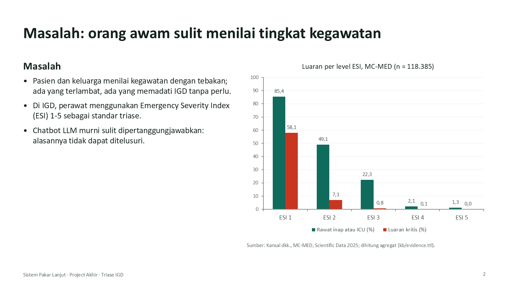
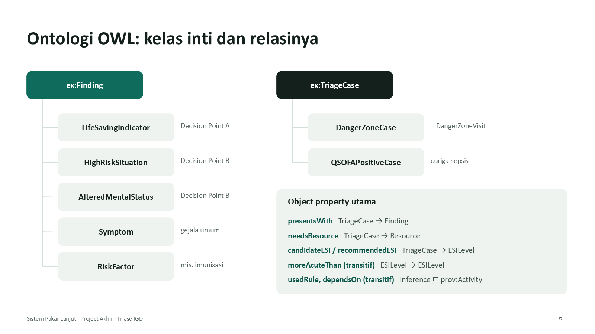
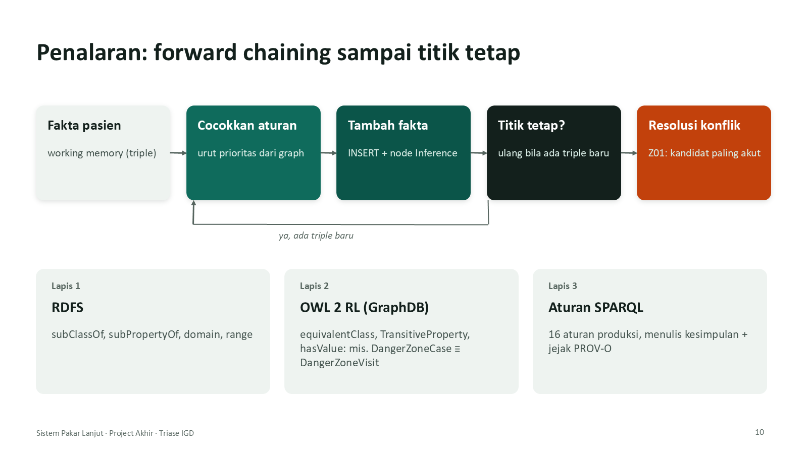
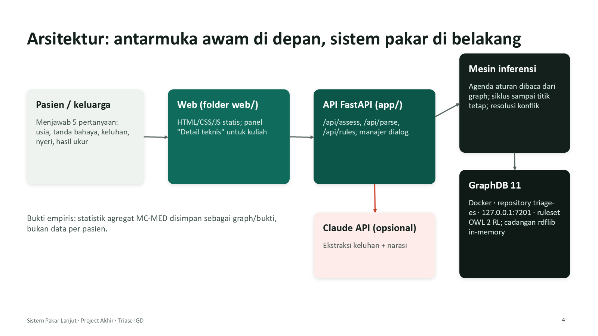
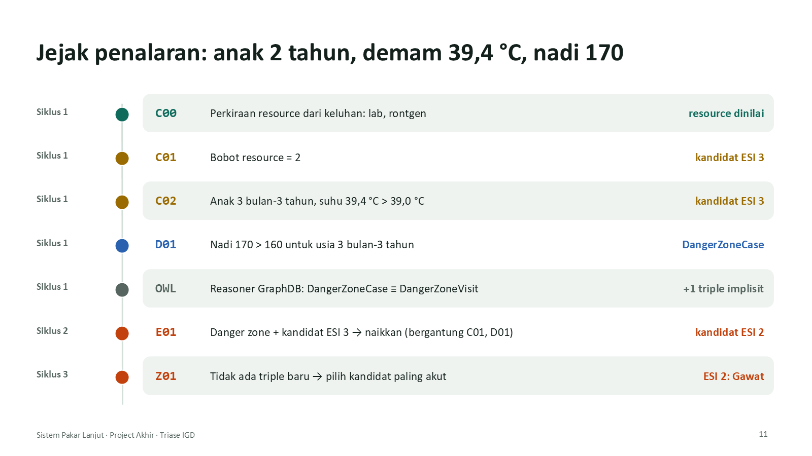
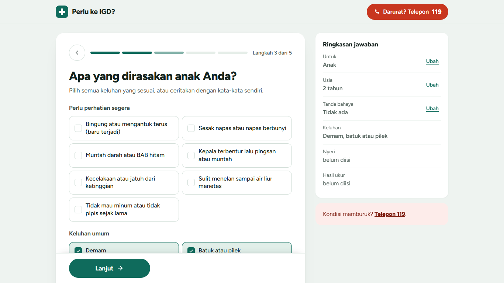
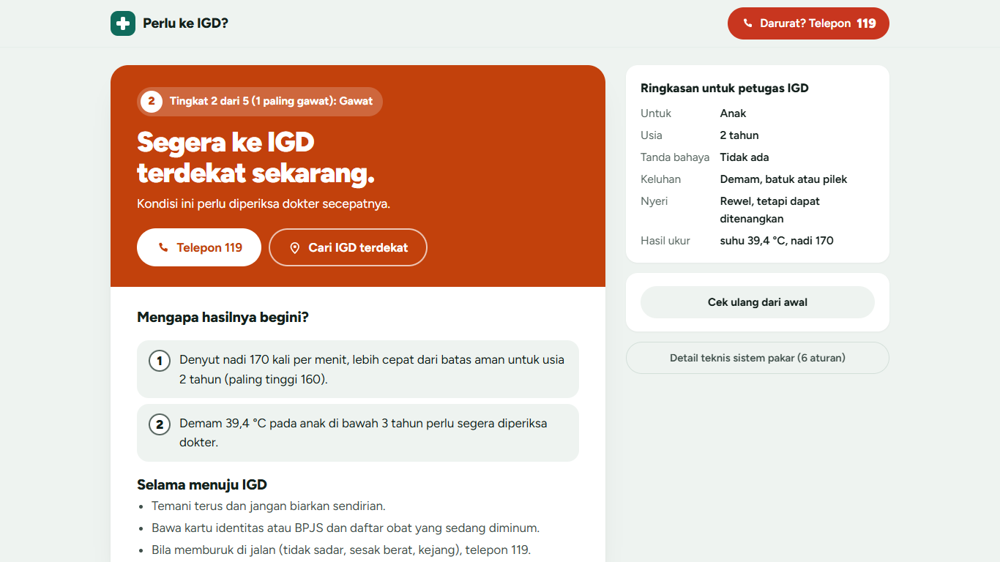
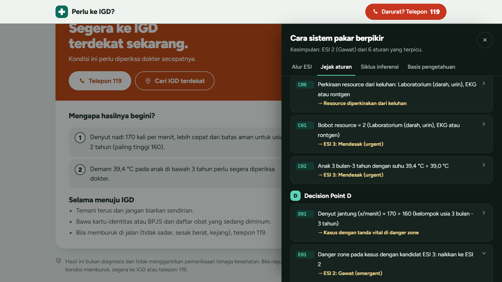

# Abstrak

Pasien dan keluarga sering kesulitan menilai apakah sebuah keluhan perlu segera ditangani di Instalasi Gawat Darurat (IGD) atau cukup diperiksa di klinik. Penilaian yang keliru dapat menunda penanganan kasus gawat atau menambah kepadatan IGD. Proyek ini membangun **Perlu ke IGD?**, aplikasi tanya-jawab untuk orang awam yang ditenagai sistem pakar triase berbasis Emergency Severity Index (ESI) versi 4. Pengetahuan direpresentasikan sebagai ontologi OWL dan knowledge graph RDF di GraphDB yang berpusat pada pengetahuan: konsep klinis, ambang danger zone per kelompok usia, resource, sinonim keluhan, pertanyaan dialog, dan 16 aturan IF-THEN disimpan sebagai data. Aturan bersumber dari *ESI Implementation Handbook* (Gilboy dkk., 2012), konsensus Sepsis-3, dan shock index, lalu ditulis sebagai SPARQL `INSERT` yang dijalankan dengan forward chaining sampai titik tetap bersama reasoner OWL 2 RL. Setiap kesimpulan meninggalkan jejak PROV-O sehingga sistem dapat menjawab pertanyaan HOW (mengapa level ini) dan WHY (mengapa pertanyaan ini diajukan). Claude API digunakan secara opsional hanya untuk mengenali keluhan teks bebas dan menulis narasi; level ESI selalu diputuskan aturan. Evaluasi meliputi 52 tes otomatis (23 kasus emas aturan, 8 uji paritas GraphDB dan rdflib, uji dialog, dan 6 uji end-to-end Playwright) serta dua putaran audit antarmuka. Statistik agregat MC-MED (118.385 kunjungan) mendukung relevansi aturan danger zone: kunjungan ESI 3-5 dengan tanda vital di danger zone memiliki proporsi luaran kritis 1,34% dibanding 0,60% pada kunjungan tanpa danger zone.

**Kata kunci:** sistem pakar, triase IGD, Emergency Severity Index, knowledge graph, OWL, SPARQL, forward chaining, penjelasan.

# 1. Pendahuluan

## 1.1 Latar belakang

Triase menentukan urutan penanganan pasien di IGD berdasarkan tingkat kegawatan. Di banyak rumah sakit, perawat menggunakan Emergency Severity Index (ESI), algoritma lima level yang menilai kebutuhan intervensi penyelamatan nyawa, situasi risiko tinggi, perkiraan jumlah resource, dan tanda vital (Gilboy dkk., 2012). Data MC-MED memperlihatkan bahwa level ESI benar-benar membedakan luaran: 58,1% kunjungan ESI 1 berakhir dengan luaran kritis, sedangkan pada ESI 4 dan 5 proporsinya hampir nol (Gambar 1).



Masalahnya, keputusan pertama untuk datang ke IGD diambil oleh pasien atau keluarga yang tidak memiliki latar medis. Chatbot berbasis model bahasa besar dapat membantu, tetapi alasannya sulit ditelusuri dan dipertanggungjawabkan untuk keputusan kritis. Sistem pakar menawarkan alternatif: pengetahuan pakar ditulis eksplisit sebagai aturan, sehingga setiap kesimpulan dapat dijelaskan langkah demi langkah.

Proyek ini melanjutkan Tugas 4 yang membangun knowledge graph triase dari 118.385 kunjungan MC-MED. Graph tersebut berpusat pada kunjungan sehingga berguna untuk analisis, tetapi tidak dapat menilai pasien baru. Proyek akhir merombaknya menjadi basis pengetahuan sistem pakar.

## 1.2 Rumusan masalah

1. Bagaimana merepresentasikan pengetahuan triase ESI v4 dalam ontologi dan knowledge graph sehingga dapat digunakan untuk menilai pasien baru?
2. Bagaimana menyusun aturan IF-THEN dari sumber pakar dan menjalankannya sebagai mekanisme penalaran yang menghasilkan kesimpulan baru beserta penjelasannya?
3. Bagaimana menyajikan sistem pakar tersebut kepada orang awam dalam bentuk percakapan yang mudah dipahami, tanpa menghilangkan keterlacakan penalarannya?

## 1.3 Tujuan

1. Merancang ontologi OWL dan knowledge graph RDF triase yang berpusat pada pengetahuan.
2. Mengodekan 16 aturan ESI v4 dan aturan pendukung sebagai aturan SPARQL yang dijalankan dengan forward chaining.
3. Menyediakan fasilitas penjelasan HOW dan WHY berbasis jejak provenance.
4. Membangun aplikasi web untuk orang awam dengan panel detail teknis untuk keperluan pembelajaran.

## 1.4 Batasan

- Domain dibatasi pada penentuan level ESI (1-5) dan saran tindakan; sistem tidak membuat diagnosis.
- Aturan bersumber dari dokumen; validasi oleh pakar klinis belum dilakukan.
- Data MC-MED hanya digunakan dalam bentuk statistik agregat sebagai bukti empiris.

# 2. Tinjauan Pustaka

## 2.1 Sistem pakar

Sistem pakar adalah program yang meniru pengambilan keputusan pakar pada domain sempit menggunakan basis pengetahuan berisi fakta dan aturan IF-THEN yang ditulis eksplisit (Giarratano dan Riley, 2005). Tiga blok pembangunnya adalah basis pengetahuan, mesin inferensi, dan antarmuka pengguna. Penalaran dapat bersifat *forward chaining* (berbasis data: dari fakta menuju kesimpulan) atau *backward chaining* (berbasis tujuan). MYCIN menjadi contoh awal sistem pakar medis yang menekankan penjelasan atas rekomendasinya (Shortliffe, 1976). Sistem pakar layak dipertimbangkan bila domain berbasis aturan yang stabil dan keputusan kritis perlu dijelaskan serta diaudit; dua kriteria ini dipenuhi oleh triase ESI.

## 2.2 Knowledge graph, RDF, RDFS, dan OWL

Knowledge graph adalah graph entitas dan relasinya yang disimpan sebagai triple RDF (subjek, predikat, objek), dengan setiap nama berupa IRI global (Hogan dkk., 2021; W3C, 2014a). RDF Schema menambahkan kosakata kelas dan property beserta aturan entailment, misalnya rdfs2 (domain), rdfs3 (range), rdfs7 (subproperty), dan rdfs9 (subclass) (W3C, 2014b). OWL 2 menambahkan konstruksi logika seperti `owl:equivalentClass`, `owl:hasValue`, `owl:disjointWith`, dan `owl:TransitiveProperty`; profil OWL 2 RL dirancang untuk mesin penalaran berbasis aturan (W3C, 2012). RDF dan OWL menganut asumsi dunia terbuka, sehingga validasi data memerlukan bahasa lain seperti SHACL (W3C, 2017).

## 2.3 Penalaran dengan SPARQL

SPARQL 1.1 Update menyediakan operasi `INSERT {template} WHERE {pola}` yang secara langsung berfungsi sebagai aturan IF-THEN: pola `WHERE` adalah badan aturan dan templat `INSERT` adalah kepalanya (W3C, 2013a). Menjalankan sekumpulan aturan berulang sampai tidak ada triple baru menghasilkan forward chaining dengan materialisasi. Jejak penalaran dapat dicatat dengan PROV-O, ontologi provenance W3C (W3C, 2013b).

## 2.4 Emergency Severity Index dan penelitian terkait

ESI v4 menilai pasien melalui empat Decision Point: (A) kebutuhan intervensi penyelamatan nyawa, (B) situasi risiko tinggi, bingung atau letargi baru, dan nyeri berat, (C) jumlah jenis resource, serta (D) tanda vital di danger zone dengan ambang berbeda per kelompok usia (Gilboy dkk., 2012). Penelitian multisenter menunjukkan akurasi triase ESI oleh perawat masih bervariasi (Mistry dkk., 2018), dan evaluasi di Amerika Serikat menemukan kejadian mistriage yang cukup besar, terutama undertriage (Sax dkk., 2023). Berbagai studi mengusulkan machine learning untuk memperbaiki triase (Levin dkk., 2018; Ivanov dkk., 2021) dan model bahasa besar untuk menilai kegawatan (Williams dkk., 2024; Masanneck dkk., 2024), tetapi pendekatan tersebut cenderung kurang dapat dijelaskan. Knowledge graph kesehatan juga pernah dibangun dari rekam medis untuk menghubungkan penyakit dan gejala (Rotmensch dkk., 2017). Benchmark luaran IGD mendefinisikan luaran kritis sebagai masuk ICU atau meninggal di rumah sakit (Xie dkk., 2022), definisi yang digunakan dalam proyek ini.

# 3. Metodologi

## 3.1 Akuisisi pengetahuan

Pengetahuan diakuisisi dari dokumen pakar:

| Sumber | Pengetahuan yang diambil |
| --- | --- |
| Gilboy dkk. (2012), Gambar 2-1, Tabel 2-1, Tabel 3-1, Tabel 4-1, Gambar 5-1 | Algoritma Decision Point A-D, kondisi penyelamatan nyawa, contoh situasi risiko tinggi per sistem organ, daftar resource dan non-resource, ambang danger zone per usia, pertimbangan demam pediatrik |
| Singer dkk. (2016) | Kriteria qSOFA untuk curiga sepsis |
| Allgöwer dan Burri (1967) | Shock index (rasio nadi dan tekanan sistolik) |
| Kansal dkk. (2025), MC-MED | Statistik agregat luaran per level ESI sebagai bukti empiris |

## 3.2 Perancangan representasi pengetahuan

Representasi dirancang berpusat pada pengetahuan, bukan pada kunjungan. Prinsip utamanya:

1. **Konsep klinis sebagai kelas**: temuan dikelompokkan menurut Decision Point (`LifeSavingIndicator`, `HighRiskSituation`, `AlteredMentalStatus`, `Symptom`, `RiskFactor`).
2. **Pengetahuan pakar sebagai data**: ambang danger zone, bobot resource, sinonim keluhan, pertanyaan dialog, dan saran awam disimpan sebagai individu sehingga dapat di-query dan diubah tanpa mengubah program.
3. **Aturan sebagai individu**: setiap aturan (`ex:Rule`) memiliki IF, THEN, prioritas, Decision Point, sumber, kalimat awam, dan berkas SPARQL.
4. **Pemisahan TBox dan ABox** dengan named graph `graph/tbox`, `graph/pengetahuan`, dan `graph/bukti`; fakta pasien menjadi working memory sementara.
5. **Provenance**: setiap penerapan aturan menulis node `ex:Inference` (subkelas `prov:Activity`).



## 3.3 Mesin inferensi

Penalaran berjalan dalam tiga lapis: entailment RDFS, entailment OWL 2 RL oleh GraphDB, dan aturan produksi SPARQL. Agenda aturan (urutan prioritas dan berkas SPARQL) dibaca dari graph. Setiap siklus menjalankan seluruh aturan; bila jumlah triple kasus tidak bertambah, titik tetap tercapai, lalu aturan Z01 memilih kandidat ESI paling akut sebagai resolusi konflik.



## 3.4 Rancangan antarmuka dan peran LLM

Antarmuka ditujukan bagi orang awam: satu pertanyaan per layar (siapa yang sakit, usia, tanda bahaya, keluhan, nyeri, hasil ukur opsional), bahasa sehari-hari, dan tombol darurat 119 yang selalu terlihat. Penjelasan teknis untuk pembelajaran disediakan dalam laci "Detail teknis" yang tertutup secara bawaan. Claude API digunakan secara opsional untuk dua tugas di tepi sistem: mengenali keluhan teks bebas menjadi ID temuan di knowledge graph dan menulis narasi dari jejak aturan. Tanpa kunci API, pengenalan keluhan menggunakan sinonim `skos:altLabel` dari knowledge graph.

## 3.5 Rancangan evaluasi

Evaluasi dilakukan dengan (1) kasus emas per aturan termasuk kasus batas ambang, (2) uji paritas hasil GraphDB dan rdflib, (3) uji alur dialog, (4) uji end-to-end di browser dengan Playwright, (5) validasi SHACL, (6) audit antarmuka oleh agen terpisah yang berperan sebagai pengguna awam, desainer UX, dan spesialis UI, serta (7) pemeriksaan relevansi aturan danger zone terhadap statistik MC-MED.

# 4. Implementasi dan Hasil

## 4.1 Arsitektur sistem



| Komponen | Teknologi | Lokasi |
| --- | --- | --- |
| Antarmuka | HTML, CSS, JavaScript statis | `web/` |
| API dan dialog | FastAPI (Python) | `app/main.py`, `app/dialog.py` |
| Mesin inferensi | rdflib (prepared SPARQL) dan GraphDB 11 (SPARQL 1.1 Protocol) | `app/engine.py`, `app/graphdb.py` |
| Basis pengetahuan | Turtle: ontologi, pengetahuan, bukti, SHACL, 16 aturan `.rq` | `kb/` |
| LLM opsional | Claude API (structured output) | `app/llm.py` |

## 4.2 Basis pengetahuan

| Elemen | Jumlah |
| --- | --- |
| Triple eksplisit | 1.053 |
| Triple tambahan dari reasoner OWL 2 RL GraphDB | 1.775 |
| Kelas OWL | 25 |
| Object property / datatype property | 24 / 36 |
| Temuan klinis / sinonim | 43 / 184 |
| Aturan IF-THEN | 16 |
| Pertanyaan dialog | 6 |
| Ambang danger zone | 9 |

Contoh pengetahuan pakar sebagai data (ambang danger zone untuk anak 3 bulan sampai 3 tahun):

```turtle
ex:DZ_HR_3m_3y a ex:DangerZoneThreshold ;
    ex:forAgeGroup ex:Age_3m_3y ; ex:onVital ex:HR ;
    ex:comparator "gt" ; ex:limit 160.0 ;
    ex:definedBy ex:Rule_D01 .
```

Rincian lengkap representasi pengetahuan beserta kaitannya dengan materi kuliah dimuat dalam dokumen pendukung *Representasi Pengetahuan dan Penalaran*.

## 4.3 Basis aturan

| Decision Point | Aturan | Kesimpulan |
| --- | --- | --- |
| A | A01 temuan mengancam nyawa · A02 SpO2 < 90% · A03 AVPU = P/U | ESI 1 |
| B | B01 situasi risiko tinggi · B02 bingung baru atau AVPU = V · B03 nyeri ≥ 7 · B04-B05 demam bayi < 3 bulan · F01 qSOFA ≥ 2 | ESI 2 |
| C | C00 perkiraan resource dari keluhan · C01 bobot resource · C02 demam anak 3 bulan-3 tahun | ESI 3, 4, atau 5 |
| D | D01 tanda vital melewati ambang usia · E01 uptriage | naik ke ESI 2 |
| Pendukung | Z01 resolusi konflik · G01 peringatan shock index | ESI akhir, peringatan |

Aturan C00 ditambahkan khusus untuk pengguna awam: karena pasien tidak dapat memperkirakan resource, aturan ini memperkirakannya dari resource khas setiap keluhan (`ex:typicalResource`), lalu memicu C01 pada siklus yang sama atau berikutnya. Daftar lengkap aturan dimuat pada Lampiran A.

## 4.4 Contoh penalaran

Kasus: anak 2 tahun dengan demam dan batuk, suhu 39,4 °C, nadi 170 kali per menit, tanpa tanda bahaya.



| Siklus | Aturan terpicu | Triple baru | Jumlah triple kasus |
| --- | --- | --- | --- |
| Awal | Working memory | 8 | 8 |
| 1 | D01, C00, C01, C02 | +30 | 38 |
| 2 | E01 (bergantung pada C01 dan D01) | +8 | 46 |
| 3 | Tidak ada | +0 | 46 (titik tetap) |
| Resolusi | Z01 | +7 | 53, ESI 2 |

Pada backend GraphDB, reasoner OWL 2 RL juga menurunkan triple implisit, misalnya kasus menjadi anggota `ex:DangerZoneVisit` melalui `owl:equivalentClass`. Dibandingkan ambang dewasa pada Tugas 4 (nadi > 100), ambang per usia mencegah salah tanda: anak 2 tahun dengan nadi 150 tidak masuk danger zone, sedangkan nadi 170 masuk.

## 4.5 Fasilitas penjelasan

- **HOW**: dari node Z01, sistem menelusuri `ex:dependsOn+` sampai fakta masukan. Setiap langkah membawa aturan, fakta yang digunakan, alasan, dan sumber pustaka.
- **WHY**: setiap pertanyaan dialog (`ex:Question`) menunjuk aturan yang membutuhkan jawabannya melalui `ex:neededBy`.
- **Dua lapis bahasa**: pasien membaca alasan awam, misalnya "Denyut nadi 170 kali per menit, lebih cepat dari batas aman untuk usia 2 tahun (paling tinggi 160)"; pengajar dan mahasiswa membuka IF-THEN, SPARQL, dan triple baru di laci detail teknis.

## 4.6 Aplikasi







## 4.7 Hasil pengujian

| Jenis uji | Jumlah | Hasil |
| --- | --- | --- |
| Kasus emas aturan (termasuk batas ambang) | 23 | Lulus |
| Uji paritas GraphDB dan rdflib | 8 | Lulus |
| Uji mesin lain (urutan siklus, transitivitas, SHACL, agenda dari graph, cakupan pertanyaan) | 8 | Lulus |
| Uji dialog dan pengenalan keluhan | 7 | Lulus |
| Uji end-to-end Playwright di Chrome | 6 | Lulus |
| **Total** | **52** | **Lulus** |

Contoh kasus emas: lansia apnea → ESI 1 (A01); dewasa nyeri dada → ESI 2 (B01); anak 2 tahun nadi 150 → ESI 3 (C01, bukan danger zone); anak 2 tahun nadi 170 → ESI 2 (D01, E01); dewasa ruam tanpa resource → ESI 5 (C00, C01).

Audit antarmuka putaran pertama menemukan 4 masalah prioritas tinggi (tombol utama di bawah lipatan layar laptop, persona pengisi yang ambigu, tombol darurat tertutup saat menggulir, dan istilah teknis di layar pasien) serta 13 masalah prioritas sedang. Putaran kedua mengonfirmasi 20 dari 23 temuan terselesaikan; satu masalah prioritas tinggi baru (keluhan mendesak berada di bawah keluhan umum) telah diperbaiki.

## 4.8 Bukti empiris aturan danger zone

| Kelompok (kunjungan ESI 3-5, MC-MED) | Kunjungan | Rawat inap atau ICU | Luaran kritis |
| --- | --- | --- | --- |
| Dengan danger zone (ambang dewasa) | 17.239 | 29,8% | 1,34% |
| Tanpa danger zone | 71.673 | 17,2% | 0,60% |

Kunjungan ESI 3-5 yang memenuhi kriteria danger zone memiliki proporsi luaran kritis sekitar 2,2 kali lipat dibanding yang tidak. Temuan ini mendukung keputusan algoritma ESI untuk mempertimbangkan uptriage (aturan E01).

# 5. Pembahasan

**Kelebihan.** Representasi berpusat pada pengetahuan membuat sistem dapat menilai pasien baru, dan menyimpan pengetahuan pakar sebagai data membuat ambang serta aturan dapat diperiksa dan diubah tanpa mengubah program. Pembagian kerja antara OWL 2 RL (konsekuensi terminologis) dan aturan SPARQL (ambang angka, hitungan resource, negasi) sesuai dengan kemampuan masing-masing formalisme. Jejak PROV-O menjadikan setiap kesimpulan dapat dijelaskan dalam dua lapis bahasa.

**Penanganan jebakan forward chaining.** Node inferensi dibentuk dengan IRI deterministik sehingga siklus pasti berhenti; satu-satunya negasi (`FILTER NOT EXISTS` pada C00) hanya memeriksa penanda yang ditulis aturan itu sendiri; working memory dibangun ulang pada setiap penilaian sehingga tidak ada kesimpulan basi; dan uji paritas memastikan dua mesin memberi hasil yang sama.

**Keterbatasan.** (1) Aturan belum divalidasi pakar klinis. (2) MC-MED hanya mencakup pasien dewasa sehingga aturan pediatrik belum diuji pada data. (3) Perkiraan resource dari keluhan (`ex:typicalResource`) masih pendekatan dari contoh kasus handbook. (4) Aturan bersifat tegas, sedangkan jawaban orang awam dapat mengandung ketidakpastian. (5) Pengguna awam tidak selalu dapat mengukur tanda vital, sehingga Decision Point D hanya aktif bila data tersedia.

# 6. Kesimpulan dan Saran

## 6.1 Kesimpulan

1. Pengetahuan triase ESI v4 berhasil direpresentasikan sebagai ontologi OWL dan knowledge graph RDF yang berpusat pada pengetahuan, dengan 1.053 triple eksplisit dan 1.775 triple turunan reasoner OWL 2 RL.
2. Sebanyak 16 aturan IF-THEN dari sumber pakar dijalankan dengan forward chaining SPARQL sampai titik tetap dan menghasilkan kesimpulan baru beserta jejak penjelasan HOW dan WHY.
3. Aplikasi *Perlu ke IGD?* menyajikan sistem pakar kepada orang awam dalam bentuk tanya-jawab berbahasa sehari-hari, dengan detail penalaran yang tetap dapat dibuka untuk pembelajaran.

## 6.2 Saran

1. Melakukan validasi aturan bersama perawat atau dokter IGD.
2. Mengevaluasi sistem pada MIMIC-IV-ED dan data pediatrik.
3. Memodelkan ketidakpastian dengan certainty factor atau logika fuzzy, sesuai materi sebelum UTS.
4. Menambah cakupan keluhan dan memetakannya ke Symptom Ontology dan ICD-10.

# Daftar Pustaka

1. Allgöwer M, Burri C. Schockindex. *Deutsche Medizinische Wochenschrift*. 1967;92(43):1947-1950.
2. Giarratano JC, Riley GD. *Expert Systems: Principles and Programming*. Edisi ke-4. Boston: Thomson Course Technology; 2005.
3. Gilboy N, Tanabe P, Travers D, Rosenau AM. *Emergency Severity Index (ESI): A Triage Tool for Emergency Department Care, Version 4. Implementation Handbook 2012 Edition*. AHRQ Publication No. 12-0014. Rockville, MD: Agency for Healthcare Research and Quality; 2011.
4. Hogan A, Blomqvist E, Cochez M, dkk. Knowledge graphs. *ACM Computing Surveys*. 2021;54(4):71.
5. Ivanov O, Wolf L, Brecher D, dkk. Improving ED Emergency Severity Index acuity assignment using machine learning and clinical natural language processing. *Journal of Emergency Nursing*. 2021;47(2):265-278.
6. Kansal A, dkk. MC-MED, multimodal clinical monitoring in the emergency department. *Scientific Data*. 2025. doi:10.1038/s41597-025-05419-5.
7. Kurniawan K. Materi kuliah Sistem Pakar Lanjut: *An Introduction to Expert Systems*; *Knowledge Representation with Knowledge Graphs*; *RDF Schema*; *Querying and Reasoning with SPARQL*. Magister Kecerdasan Artifisial, Universitas Gadjah Mada; 2026.
8. Levin S, Toerper M, Hamrock E, dkk. Machine-learning-based electronic triage more accurately differentiates patients with respect to clinical outcomes compared with the Emergency Severity Index. *Annals of Emergency Medicine*. 2018;71(5):565-574.
9. Masanneck L, Schmidt L, Seifert A, dkk. Triage performance across large language models, ChatGPT, and untrained doctors in emergency medicine: comparative study. *Journal of Medical Internet Research*. 2024;26:e53297.
10. Mistry B, Stewart De Ramirez S, Kelen G, dkk. Accuracy and reliability of emergency department triage using the Emergency Severity Index: an international multicenter assessment. *Annals of Emergency Medicine*. 2018;71(5):581-587.
11. Rotmensch M, Halpern Y, Tlimat A, Horng S, Sontag D. Learning a health knowledge graph from electronic medical records. *Scientific Reports*. 2017;7:5994.
12. Sax DR, Warton EM, Mark DG, dkk. Evaluation of version 4 of the Emergency Severity Index in US emergency departments for the rate of mistriage. *JAMA Network Open*. 2023;6(3):e233404.
13. Shortliffe EH. *Computer-Based Medical Consultations: MYCIN*. New York: Elsevier; 1976.
14. Singer M, Deutschman CS, Seymour CW, dkk. The Third International Consensus Definitions for Sepsis and Septic Shock (Sepsis-3). *JAMA*. 2016;315(8):801-810.
15. W3C. *OWL 2 Web Ontology Language Profiles (Second Edition)*. W3C Recommendation; 2012.
16. W3C. *SPARQL 1.1 Update*. W3C Recommendation; 2013a.
17. W3C. *PROV-O: The PROV Ontology*. W3C Recommendation; 2013b.
18. W3C. *RDF 1.1 Concepts and Abstract Syntax*. W3C Recommendation; 2014a.
19. W3C. *RDF Schema 1.1*. W3C Recommendation; 2014b.
20. W3C. *Shapes Constraint Language (SHACL)*. W3C Recommendation; 2017.
21. Williams CYK, Zack T, Miao BY, dkk. Use of a large language model to assess clinical acuity of adults in the emergency department. *JAMA Network Open*. 2024;7(5):e248895.
22. Xie F, Zhou J, Lee JW, dkk. Benchmarking emergency department prediction models with machine learning and public electronic health records. *Scientific Data*. 2022;9:658.

# Lampiran A. Daftar Aturan

| ID | Prioritas | IF | THEN | Sumber |
| --- | --- | --- | --- | --- |
{{RULES}}

# Lampiran B. Cara Menjalankan

Kode sumber, basis pengetahuan, dan tes tersedia di repository publik https://github.com/hamzaharmanhusni-ugm/sistem-pakar-triase-igd.

```text
python -m venv .venv
.venv\Scripts\activate
pip install -r requirements.txt
docker run -d --name graphdb11 -p 7201:7200 ontotext/graphdb:11.5.2
python -m app.graphdb
uvicorn app.main:app --port 8000
python -m pytest -q
```

Aplikasi dibuka di http://localhost:8000. Tanpa GraphDB, sistem menggunakan rdflib in-memory; tanpa kunci Claude API, sistem berjalan dalam mode lokal.
