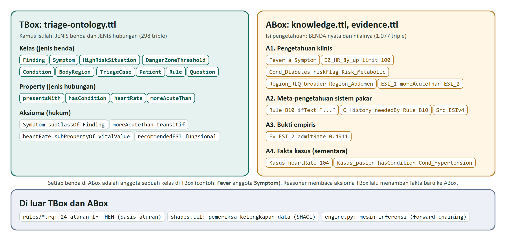
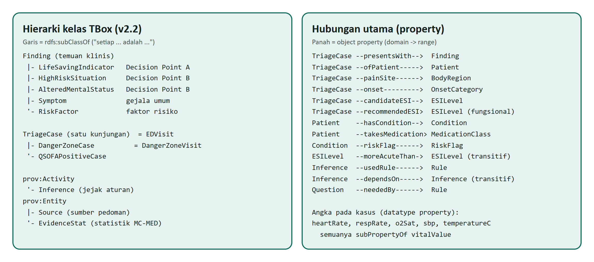
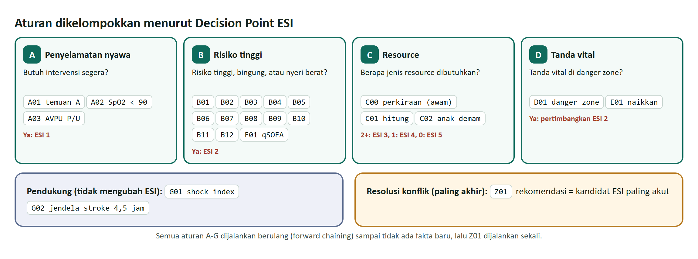

# 1. Gambaran Singkat

Sistem pakar triase IGD *Perlu ke IGD?* terdiri dari tiga blok:

| Blok | Pertanyaan | Wujud di proyek |
| --- | --- | --- |
| Basis pengetahuan | Apa yang diketahui pakar? | **TBox** (`kb/triage-ontology.ttl`) dan **ABox** (`kb/knowledge.ttl`, `kb/evidence.ttl`) |
| Basis aturan | Bagaimana pakar menyimpulkan? | 24 aturan SPARQL (`kb/rules/*.rq`) |
| Mesin inferensi | Bagaimana kesimpulan dihitung dan dijelaskan? | `app/engine.py` (forward chaining) dan reasoner OWL 2 RL di GraphDB |



**Kalimat kunci:** TBox mendefinisikan *jenis* benda dan hubungannya; ABox mengisi *benda nyatanya*; aturan SPARQL menarik kesimpulan klinis; reasoner menambah fakta yang pasti benar menurut definisi.

Setiap fakta ditulis sebagai **triple** (subjek, predikat, objek). Contoh: `ex:Fever skos:prefLabel "Demam"@id` dibaca "Demam bernama resmi *Demam*". Tanda `a` berarti "adalah anggota kelas", `;` berarti subjek sama dengan predikat baru, dan `.` mengakhiri pernyataan.

# 2. TBox: Kamus Istilah

## 2.1 Pengertian dan cara mengenali

TBox mendefinisikan **jenis benda** (kelas), **jenis hubungan** (property), dan **hukum** di antara keduanya (aksioma). TBox tidak menyebut satu pun pasien atau penyakit tertentu.

**Uji sederhana: lihat subjek triple-nya.** Bila subjeknya kelas atau property, triple itu TBox. Bila subjeknya benda tertentu, triple itu ABox.

| Triple | Subjek | Kelompok |
| --- | --- | --- |
| `ex:Symptom rdfs:subClassOf ex:Finding` | Kelas *Symptom* | TBox |
| `ex:Fever a ex:Symptom` | Benda *Demam* | ABox |

## 2.2 Isi TBox



| Kelompok kelas | Contoh | Peran |
| --- | --- | --- |
| Pengetahuan klinis | `Finding` dan 5 subkelasnya, `DangerZoneThreshold`, `Resource` | Jenis isi pedoman ESI |
| Model pasien | `Patient`, `Condition`, `MedicationClass`, `RiskFlag`, `BodyRegion` | Jenis informasi anamnesis |
| Kasus | `TriageCase`, `DangerZoneCase` | Satu konsultasi dan kelas turunannya |
| Meta sistem pakar | `Rule`, `Question`, `Source`, `Inference` | Aturan, pertanyaan, sumber, jejak |

## 2.3 Empat aksioma terpenting

| Aksioma | Arti | Akibat bagi aplikasi |
| --- | --- | --- |
| `Symptom subClassOf Finding` | Setiap gejala adalah temuan | 44 temuan dapat dicari sekaligus sebagai `Finding` |
| `heartRate subPropertyOf vitalValue` | Nadi adalah salah satu tanda vital | Semua tanda vital terambil dengan satu query |
| `moreAcuteThan` transitif | Bila A > B dan B > C, maka A > C | Urutan ESI dan rantai penjelasan lengkap tanpa ditulis tangan |
| `EDVisit equivalentClass TriageCase` | Dua nama untuk kelas yang sama | Kasus aplikasi dapat dibandingkan dengan data MC-MED |

## 2.4 Mengapa ini TBox, dan perannya bagi aplikasi

Isi `triage-ontology.ttl` **berlaku umum** (benar untuk semua pasien), **membicarakan jenis** (subjeknya kelas atau property), dan **jarang berubah** (menambah penyakit tidak mengubahnya).

Perannya di kode:

- **Kategori formulir.** `engine.vocab()` menanyakan anggota setiap kelas, lalu hasilnya menjadi pilihan jawaban di formulir perawat melalui `/api/vocab`.
- **Penjaga data.** `/api/assess` menolak jawaban yang bukan anggota kelas yang benar.
- **Bahan reasoner.** `engine.knowledge_base()` memuat TBox dan menjalankan reasoner OWL 2 RL.

# 3. ABox: Isi Pengetahuan

## 3.1 Pengertian

ABox berisi **pernyataan tentang benda nyata**, dan setiap benda adalah anggota sebuah kelas TBox. Bila TBox adalah kamus, ABox adalah isi buku pedoman yang ditulis dengan kata-kata dari kamus itu.

## 3.2 Empat subkelompok, satu contoh masing-masing

| Subkelompok | Contoh triple | Dibaca oleh |
| --- | --- | --- |
| A1. Pengetahuan klinis | `ex:DZ_HR_8y_up ex:onVital ex:HR ; ex:comparator "gt" ; ex:limit 100.0` | Aturan D01 |
| A2. Meta-pengetahuan | `ex:Rule_B10 ex:ifText "..." ; dcterms:source ex:Src_ESIv4 ; ex:sparqlFile "rules/B10_muntah_diabetes.rq"` | `engine.agenda()`, panel penjelasan |
| A3. Bukti empiris | `ex:Ev_ESI_2 ex:visits 27880 ; ex:admitRate 0.4911` | Layar hasil |
| A4. Fakta kasus (sementara) | `:Kasus ex:heartRate 104` dan `:Kasus_pasien ex:hasCondition ex:Cond_Hypertension` | Aturan; dibuat `engine.case_graph()` dari formulir |

**Pengetahuan disimpan sebagai data.** Angka 100 pada ambang nadi tidak ditulis di kode Python maupun di aturan; aturan D01 membacanya dari ABox. Bila pedoman berubah, cukup satu angka yang diganti.

**Riwayat dibaca melalui penanda risiko.** `ex:Cond_Diabetes ex:riskFlag ex:Risk_Metabolic`. Aturan B10 menanyakan "adakah riwayat atau obat bertanda `Risk_Metabolic`", bukan menyebut diabetes satu per satu.

## 3.3 Yang terlihat seperti TBox, tetapi ABox

| Isi di knowledge.ttl | Mengapa tetap ABox |
| --- | --- |
| `ex:Fever a ex:Symptom` | Menyatakan keanggotaan satu benda; definisi kelasnya ada di TBox |
| `ex:Region_RLQ skos:broader ex:Region_Abdomen` | Hierarki antarbenda (SKOS), bukan antarkelas (`subClassOf`) |
| `ex:ESI_1 ex:moreAcuteThan ex:ESI_2` | Hubungan dua benda; sifat transitifnya yang TBox |
| `ex:Rule_B10 ex:ifText "..."` | Keterangan tentang satu aturan; logikanya ada di berkas `.rq` |

Konsep klinis sengaja dimodelkan sebagai **benda** (bukan kelas) agar dapat diberi sinonim, resource khas, dan penanda risiko secara langsung.

## 3.4 Peran ABox bagi aplikasi

| Isi ABox | Hasil di aplikasi |
| --- | --- |
| Temuan, riwayat, obat, wilayah tubuh | Pilihan jawaban di formulir |
| Sinonim (`skos:altLabel`) | Teks bebas "dada terasa berat" dikenali sebagai nyeri dada |
| Ambang dan penanda risiko | Dibaca aturan untuk menentukan kegawatan |
| Kartu aturan dan pertanyaan | Urutan eksekusi, penjelasan HOW dan WHY, sumber |
| Bukti MC-MED | "Dari 27.880 kunjungan ESI 2, 49% dirawat inap" |

# 4. Reasoner: Informasi Baru dari TBox

Reasoner membaca aksioma TBox lalu menambah fakta ke ABox. Di GraphDB, 1.375 triple tulisan tangan menjadi 3.415 triple (2.040 hasil penalaran). Contoh yang bermakna:

| Fakta baru | Dari aksioma |
| --- | --- |
| ESI 1 lebih gawat dari ESI 3, 4, dan 5 | `moreAcuteThan` transitif |
| Kasus nyeri dada adalah `EDVisit` dan `DangerZoneVisit` | `equivalentClass` |
| Nadi 104, napas 22, TD 165 menjadi `vitalValue` | `subPropertyOf` |
| Z01 bergantung pada C01 dan D01 | `dependsOn` transitif |

**Dunia terbuka.** Reasoner tidak menolak data keliru, melainkan menyimpulkan. Bila aplikasi keliru mengirim `hasCondition ex:Fever`, reasoner menyimpulkan "Demam adalah riwayat penyakit". Karena itu proyek menggunakan SHACL (`kb/shapes.ttl`) yang memeriksa dengan dunia tertutup dan menolak data tersebut.

# 5. Aturan IF-THEN

## 5.1 Dua bagian setiap aturan

| Bagian | Tempat | Isi |
| --- | --- | --- |
| Logika | `kb/rules/B10_muntah_diabetes.rq` | SPARQL `INSERT ... WHERE` |
| Kartu identitas | `ex:Rule_B10` di `knowledge.ttl` | Prioritas, teks IF-THEN, sumber, kalimat awam |

Mesin inferensi membaca daftar aturan dari kartu-kartu ini (`engine.agenda()`), sehingga menambah aturan tidak mengubah kode Python.

## 5.2 Anatomi satu aturan

```sparql
INSERT { ?case ex:candidateESI ex:ESI_2 .  ?inf a ex:Inference ; ex:usedRule ex:Rule_B10 ; ex:reason ?why . }
WHERE  { ?case ex:presentsWith ex:VomitingDiarrhea ; ex:ofPatient ?pt .
         ?pt ex:hasCondition ?x .  ?x ex:riskFlag ex:Risk_Metabolic . ... }
```

- **WHERE (JIKA):** kasus mengeluh muntah atau diare, DAN pasiennya memiliki riwayat bertanda risiko metabolik.
- **INSERT (MAKA):** kasus mendapat kandidat ESI 2, dan jejak penalaran dicatat untuk penjelasan.

## 5.3 Forward chaining dan resolusi konflik

`engine._chain()` menjalankan semua aturan berulang kali sampai **tidak ada fakta baru** (titik tetap). Pengulangan diperlukan karena sebagian aturan membaca hasil aturan lain: D01 menyimpulkan danger zone pada siklus 1, lalu E01 membacanya pada siklus 2. Setelah itu Z01 memilih kandidat ESI **paling akut** sebagai rekomendasi.



## 5.4 Daftar 24 aturan

| ID | Kelompok | JIKA | MAKA |
| --- | --- | --- | --- |
{{RULES_SHORT}}

# 6. Satu Kasus dari Awal sampai Akhir

Pasien laki-laki 58 tahun, nyeri di dada, riwayat hipertensi dan diabetes, nadi 104, napas 22, TD 165, perkiraan resource laboratorium dan EKG.

| Langkah | Komponen | Yang terjadi |
| --- | --- | --- |
| 1 | Formulir (`web/app.js`) | Jawaban dikirim sebagai JSON ke `/api/assess` |
| 2 | TBox (validasi API) | Setiap pilihan diperiksa sebagai anggota kelas yang benar |
| 3 | ABox sementara (`case_graph()`) | 13 triple fakta kasus, misalnya `:Kasus ex:heartRate 104` |
| 4 | Aturan, siklus 1 | B12: nyeri dada + hipertensi = ESI 2. D01: nadi 104 > 100 dan napas 22 > 20 = danger zone. C01: 2 resource = ESI 3 |
| 5 | Aturan, siklus 2 | E01: danger zone pada kandidat ESI 3 = naikkan ke ESI 2 |
| 6 | Aturan, siklus 3 | Tidak ada fakta baru: titik tetap |
| 7 | Resolusi konflik (Z01) | Kandidat ESI 2 dan 3: rekomendasi **ESI 2** |
| 8 | Reasoner (TBox) | Kasus menjadi `DangerZoneVisit`; rantai `dependsOn` dilengkapi |
| 9 | Penjelasan | Layar menampilkan ESI 2, dasar keputusan B12, C01, D01, E01 beserta sumbernya, dan ringkasan SBAR |

# 7. Ringkasan

| Komponen | Pertanyaan | Berkas | Contoh | Peran di aplikasi |
| --- | --- | --- | --- | --- |
| TBox | Jenis apa saja yang ada? | `triage-ontology.ttl` | `Symptom subClassOf Finding` | Kategori formulir, validasi, aksioma reasoner |
| ABox klinis | Benda apa dan nilainya? | `knowledge.ttl` | `DZ_HR_8y_up limit 100` | Pilihan jawaban, ambang, penanda risiko |
| ABox meta | Aturan dan pertanyaan apa? | `knowledge.ttl` | `Rule_B10 ifText "..."` | Agenda, penjelasan HOW dan WHY |
| ABox bukti | Apa kata data? | `evidence.ttl` | `Ev_ESI_2 admitRate 0.4911` | Bukti di layar hasil |
| Fakta kasus | Bagaimana kondisi pasien ini? | Working memory | `Kasus heartRate 104` | Masukan dan keluaran penalaran |
| Aturan | Bagaimana menyimpulkan? | `rules/*.rq` | B10 | Kandidat ESI |
| SHACL | Apakah datanya layak? | `shapes.ttl` | `hasCondition sh:class Condition` | Menolak data keliru |

Rincian lengkap setiap aturan (contoh kasus yang dijalankan mesin inferensi dan kode SPARQL-nya) tersedia di dokumen *Bahan Ajar - TBox, ABox, dan Aturan Sistem Pakar Triase IGD*.
